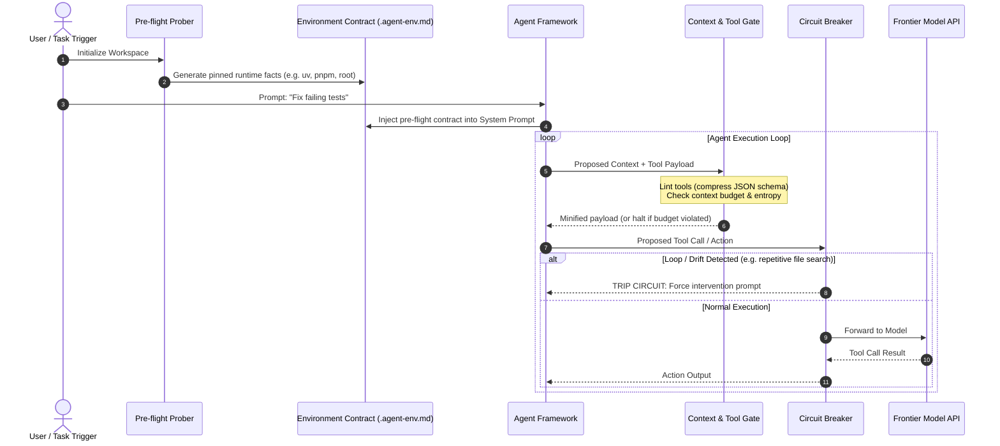

# Token Bleed Shield: Architecture & System Design

> **Scope**: this document covers the current **CLI tool** (prober, gates, breaker). The
> forward-looking **platform architecture** — inline proxy SaaS, tiered detection engine,
> savings ledger, BYOC/self-hosted topologies — lives in
> [`docs/architecture/`](architecture/README.md). The CLI guards here are the Phase-0
> seed of that detection engine (see [architecture/03-detection-engine.md](architecture/03-detection-engine.md)).

## 1. Design Philosophy

> **Rule 0**: Any token spent discovering what was already knowable is waste.
> **Rule 1**: Intervene before the payload hits the wire, never in the post-mortem billing dashboard.

Traditional LLM observability stacks (e.g. LangSmith, Helicone, Portkey) are diagnostic post-processors. They capture traces, token counts, and latency, presenting them in analytics charts. While invaluable for debugging, **they cannot prevent an active agent from bleeding $50 in an infinite exploration loop**.

Token Bleed Shield (TBS) is engineered as a **pre-execution guardrail layer** sitting directly between the agent/developer and the model inference provider.

---

## 2. System Flow



---

## 3. Core Subsystems

### 3.1 Pre-Flight Environment Prober (`prober/`)
- **Objective**: Eliminate system reconnaissance loops.
- **Problem**: When an agent receives a command like *"run tests"*, without strict environment context it typically runs:
  1. `python --version` (or `which python`)
  2. `pip list`
  3. `find . -name "*.py"`
  4. Trial-and-error shell executions.
  Each exploration step burns ~800 to 2,000 tokens of round-trip context.
- **Solution**: The prober probes the system once using deterministic local OS checks (e.g. detecting `uv`, `poetry`, `npm`, `pnpm`, `cargo`, OS family, path conventions) and emits an immutable contract (`.agent-env.md`).
- This file is automatically loaded into the LLM's system prompt or project context file (e.g., `CLAUDE.md`, `.cursorrules`, `AGENT.md`).

### 3.2 Tool & Schema Minifier (`tools/schema_linter.py`)
- **Objective**: Reduce static token overhead in function/MCP calling.
- **Problem**: Standard Model Context Protocol (MCP) and JSON Schema definitions often include:
  - Redundant parameter descriptions
  - Verbose markdown comments in schemas
  - Default values that are self-explanatory
  - Unused or rarely invoked tools bundled into every single call.
- **Solution**:
  - Prunes optional schema fluff (e.g. `title`, excessive markdown formatting in descriptions).
  - Flags duplicate or oversized tools.
  - Generates token-compressed schema payloads, saving 40-60% of static prompt tokens.

### 3.3 Context Budget Gate (`guards/context_budget.py`)
- **Objective**: Prevent context window bloat and truncation.
- **Problem**: Agents routinely ingest 5,000 lines of raw compiler output or unpruned log dumps. The model reaches context limit, drops previous reasoning steps, and starts hallucinating.
- **Solution**:
  - Pre-flight token estimator.
  - High-entropy detector (identifies raw minified JS, base64 strings, repetitive logs).
  - Truncation / summarize-first enforcement before the request is dispatched.

### 3.4 Drift & Loop Circuit Breaker (`guards/circuit_breaker.py`)
- **Objective**: Terminate agent wandering before it burns credit allowances.
- **Detection Criteria**:
  1. **Repetitive Action Index**: Same tool called with identical or near-identical arguments within a 3-turn window.
  2. **Error Cascade**: Repeated shell non-zero exit codes (e.g. agent fails 3 times trying to invoke `python` instead of `uv run`).
  3. **Clarification Stalemate**: Model asking the user open-ended non-actionable questions without making progress.
- **Action**: Immediately trips the circuit breaker, stopping the loop and outputting a pinpoint error report.

---

## 4. Contract Specification (`.agent-env.md`)

```markdown
<!-- AUTO-GENERATED BY TOKEN BLEED SHIELD (DO NOT EDIT MANUALLY) -->
# ENVIRONMENT PINNING CONTRACT
- OS: Windows 11 (PowerShell 7)
- Python Runtime: astral-uv (v0.6.x)
- Python Execution Command: `uv run`
- Dependency Management: `uv pip`, `uv add`
- NEVER RUN: `python`, `pip`, `python3` directly.
- Node Runtime: pnpm (v9.x)
- Working Directory: C:\Users\PRANAV PATIL\my-project
- Disallowed Actions: Recursive filesystem searches, scanning system PATH.
```
