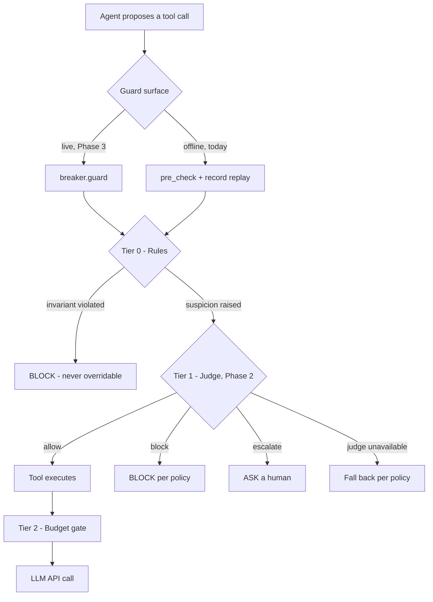

# Token Bleed Shield: Proposed Architecture

> **Status: PROPOSED.** Phase 1 of this document is **implemented** on the
> `feat/phase-1-prevention-foundation` branch. Phases 2 and 3 are **design intent**, not
> shipped behaviour. This file records the target architecture and the reasoning behind it;
> [`ARCHITECTURE.md`](ARCHITECTURE.md) describes the original design.

---

## 1. Why a second document exists

The original architecture described guardrails that *sit in the agent loop* and *halt execution
mid-flight*. The original implementation was four offline analyzers you invoked by hand. The gap
between the two is the reason this document exists.

The single sharpest example, using the repository's own example file
(`examples/agent_history_drift.jsonl`):

```json
{"tool_name": "run_shell_command", "arguments": {"command": "python -m unittest"}, "return_code": 1, "error_message": "python: command not found"}
```

An agent tried `python`. The prober had **already recorded** that `python` is forbidden on a `uv`
managed machine (`system_prober.py`, `forbidden_alternatives=["python", "python3", "pip", "pipenv"]`).
That knowledge was written into a markdown file and never read again.

| | Calls wasted | When the system noticed |
|---|---|---|
| Before | 3 | After the third failure |
| After | **0** | Before the first call |

Phase 1 closes that gap. Phases 2 and 3 generalise the idea.

---

## 2. Target flow



### Tier 0 — Rules (deterministic, free, always on)

Zero-cost checks that run on 100% of calls. A violation here is a provable waste, so the judge
cannot overrule it.

| Signal | Meaning | Threshold |
|---|---|---|
| `forbidden_command` | The invoked binary is blacklisted by the environment contract | 1st attempt |
| `identical_args` | Same tool, byte-identical arguments as the previous call | 2nd identical |
| `same_tool_streak` | Same tool repeatedly, differing arguments (reconnaissance sweep) | 3rd consecutive |
| `repeated_error_signature` | The same bucketed failure repeating | 2nd consecutive |
| `error_cascade` | Consecutive failures of any signature | 3rd consecutive |
| `oscillation` | Cyclic `A -> B -> A -> B` tool pattern | 4th step |

### Tier 1 — Judge (probabilistic, cheap, on suspicion only)

A small model adjudicates the cases rules cannot decide: *is this a wasteful loop, or legitimate
work that happens to look repetitive?*

### Tier 2 — Budget (arithmetic)

Token thresholds from the context budget gate. No model, no judgement.

---

## 3. Enforcement is a preference, never hardcoded

Each rule carries an enforcement level, resolved per rule with a global fallback:

```yaml
circuit_breaker:
  default_enforcement: warn        # block | warn | ask | off
  rules:
    forbidden_command: { enforcement: block }
    identical_args:    { enforcement: block }
    repeated_error_signature: { enforcement: warn }
    error_cascade:     { enforcement: warn }
    same_tool_streak:   { enforcement: warn }
    oscillation:       { enforcement: warn }
```

| Level | Effect |
|---|---|
| `block` | Prevent the action before it executes |
| `warn` | Report it and let the action proceed |
| `ask` | Escalate to a human for an explicit decision |
| `off` | Ignore the rule entirely |

Two fields on the verdict keep *detection* and *action* separate, which is what makes the
preference model work:

- `tripped` — a rule fired
- `block` — the caller must prevent execution

A `warn` rule fires and reports; it does not halt the agent.

---

## 4. The contract is the interface between subsystems

`.agent-env.md` serves two audiences from one artifact: prose for the agent's system prompt, and
a fenced JSON block for guardrails.

````markdown
<!-- TBS-CONTRACT-JSON -->
```json
{
  "contract_version": 1,
  "python": {
    "name": "uv",
    "command_prefix": "uv run",
    "forbidden": ["python", "python3", "pip", "pipenv"]
  }
}
```
<!-- /TBS-CONTRACT-JSON -->
````

`ContractParser` reads the block into a `ContractSnapshot`. The breaker consumes
`snapshot.forbidden_commands`. The prober produces the contract. **This is the wire that was
missing in the original implementation** — the prober already knew what was forbidden, and the
enforcement point could not see it.

### Command matching is head-based

The forbidden-command check matches the binary being *invoked*, never a substring:

| Command | Forbidden list contains `python` | Result |
|---|---|---|
| `python -m unittest` | yes | **violation** |
| `uv run python app.py` | yes | allowed — `uv run` is the sanctioned entry point |
| `/usr/bin/python app.py` | yes | **violation** — basename is `python` |
| `cat src/python` | yes | allowed — `cat` is the command head |
| `uv run pytest && pip install x` | `pip` | **violation** — chained segments are checked individually |

---

## 5. Error signatures

Raw error strings are noisy, unbounded and agent-controlled. They are bucketed into a closed
vocabulary so that "the same failure twice" is detectable at all:

`command_not_found` · `not_found` · `permission_denied` · `timeout` · `network` · `rate_limited` ·
`import_error` · `syntax_error` · `unknown` · `none`

The distinction that matters: `command_not_found` means the agent used the **wrong binary** (a
loop), whereas `not_found` usually means a file is simply absent (normal progress). A cascade of
*distinct* signatures is legitimate work and must not trip the breaker.

---

## 6. Phase 2 — the judge in the loop

### 6.1 The digest

The judge receives a narrow, structured digest. Never raw agent output: that would be unbounded in
cost, unstable as training data, and an injection surface.

```json
{
  "v": 1,
  "tool": "run_shell_command",
  "action_kind": "shell",
  "target_hint": "python",
  "recent": [
    {"tool": "run_shell_command", "kind": "shell", "outcome": "error",
     "error_sig": "command_not_found", "target": "python"}
  ],
  "counters": {"same_tool_streak": 3, "error_streak": 2, "distinct_targets": 2,
               "tokens_spent": 14500, "turn": 7},
  "signals": ["repeated_error_signature", "forbidden_binary_near_miss"],
  "contract": {"prefix": "uv run", "forbidden": ["python", "pip"]},
  "policy": {"enforcement": "warn", "budget_remaining": 0.62}
}
```

**The digest schema version is frozen at `v: 1`.** Changing it invalidates every training
example collected so far.

The Python collector does the counting, the bucketing and the lookup. The model answers exactly
one question: *given these signals, is this a wasteful loop or legitimate work?*

### 6.2 The verdict

```json
{ "decision": "block" | "allow" | "escalate", "confidence": 0.94 }
```

The explanation is **not** generated by the model. The rules engine already knows which signal
fired, so it can explain itself for free, deterministically, and traceably:

```
🚨 Circuit breaker: BLOCK
   Signal : repeated_error_signature (command_not_found x2 on target "python")
   Judge  : block (confidence 0.94)
   Contract violation: forbidden binary "python" - expected prefix `uv run`
```

Model-generated prose is reserved for an explicit `--explain` debug mode.

### 6.3 Economics

Prices as of October 2026 (verify before budgeting):

| Model | Input /1M | Output /1M |
|---|---|---|
| Gemini 2.5 Flash-Lite | $0.10 | $0.40 |
| Gemini 3.5 Flash-Lite | $0.30 | $2.50 |
| Gemini 3.8 Flash | $0.75 | $3.75 |
| Gemini 3.1 Pro (frontier) | $2.00 | $12.00 |

One judge check on Flash-Lite, with a 400-token digest and a 40-token verdict:

```
400/1e6 x $0.30  +  40/1e6 x $2.50  =  $0.00022   (0.02 cents)
```

One prevented reconnaissance loop of ~14,500 tokens on a frontier model:

```
14,500/1e6 x $2.00  =  $0.029
```

**Break-even: the judge must catch 1 in ~132 judged calls.** Latency, not cost, is the binding
constraint: an API round trip is ~300-600 ms, so the judge runs on flagged calls only, never on
every call. A local model (Ollama) removes the network dependency entirely.

### 6.4 Shadow mode first

The judge ships disabled and in shadow mode. Every verdict is logged as
`(digest, decision, confidence)`. Disagreements with the rules engine are human-reviewed, and
that log becomes the fine-tuning set. A locally fine-tuned classifier (single-token output over
`{allow, block, escalate}`, confidence read from the logits) is the eventual target: one forward
pass, calibrated confidence, no generation, no non-determinism.

### 6.5 Backend portability

One OpenAI-compatible adapter covers Gemini, OpenAI, Ollama, vLLM, LM Studio and Groq:

```
https://generativelanguage.googleapis.com/v1beta/openai/     # Gemini
http://localhost:11434/v1                                    # Ollama
```

The core package stays dependency-free: the adapter speaks plain HTTP via `urllib`, and
`NullJudge` provides rules-only behaviour when no endpoint is configured.

---

## 7. Phase 3 — integration

### 7.1 One-line integration surface

```python
from token_bleed_shield.guards import AgentAction, DriftCircuitBreaker

breaker = DriftCircuitBreaker(config, contract=contract)

def guard(tool_name: str, arguments: dict) -> str | None:
    verdict = breaker.pre_check(AgentAction(tool_name=tool_name, arguments=arguments))
    if verdict and verdict.block:
        return verdict.reason
    return None
```

Any framework's tool dispatcher wraps its call in `guard()`.

### 7.2 SDK middleware

The roadmap item "middleware proxy for OpenAI/Anthropic client SDKs" is where the four
subsystems finally meet the wire:

```
request -> minify tools -> budget gate -> LLM
```

### 7.3 Replay honesty

`tbs breaker --history` is a **replay**, not prevention. It answers "what would a live guardrail
have done with this history?" and it says so:

```
Preventable before execution: 3 step(s) -> 1, 3, 4
Detected only after execution: 0 step(s)
Replay assumes the agent retried identically after a block; real behaviour may diverge.
```

---

## 8. Implementation status

| Component | Status | Location |
|---|---|---|
| Machine-readable contract | **Implemented** | `contract.py`, `prober/contract_generator.py` |
| Contract parser | **Implemented** | `contract.py` |
| Signal taxonomy | **Implemented** | `policy.py` |
| Enforcement policy resolution | **Implemented** | `policy.py`, `config.py` |
| Error-signature bucketing | **Implemented** | `guards/signals.py` |
| Pre-dispatch gate | **Implemented** | `guards/circuit_breaker.py::pre_check` |
| Post-dispatch detection | **Implemented** | `guards/circuit_breaker.py::record` |
| Configuration loading | **Implemented** | `config.py`, `cli.py` |
| Judge protocol and adapters | Proposed | `judge/` (Phase 2) |
| Digest builder | Proposed | `guards/digest.py` (Phase 2) |
| Shadow recorder | Proposed | `judge/shadow.py` (Phase 2) |
| Live `guard()` surface | Proposed | `guards/circuit_breaker.py` (Phase 3) |
| SDK middleware proxy | Proposed | `middleware.py` (Phase 3) |
