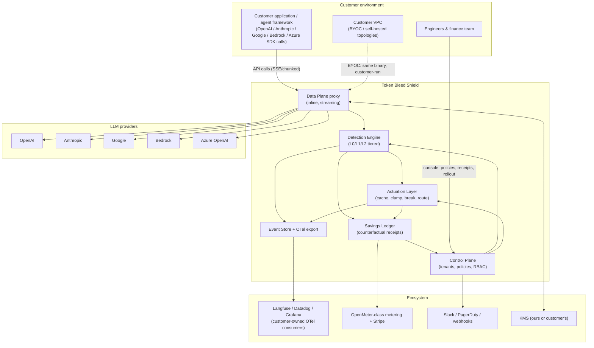
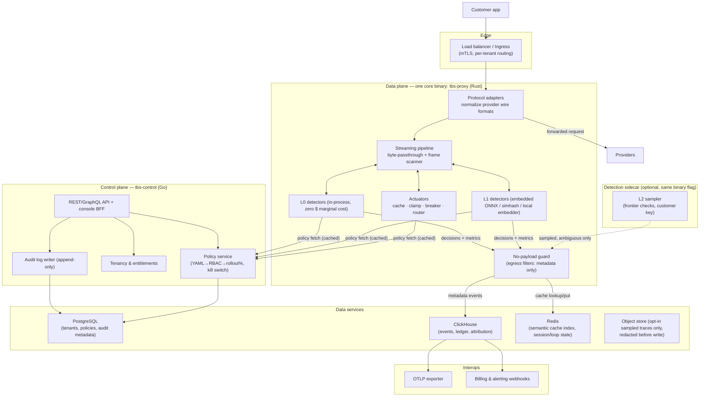
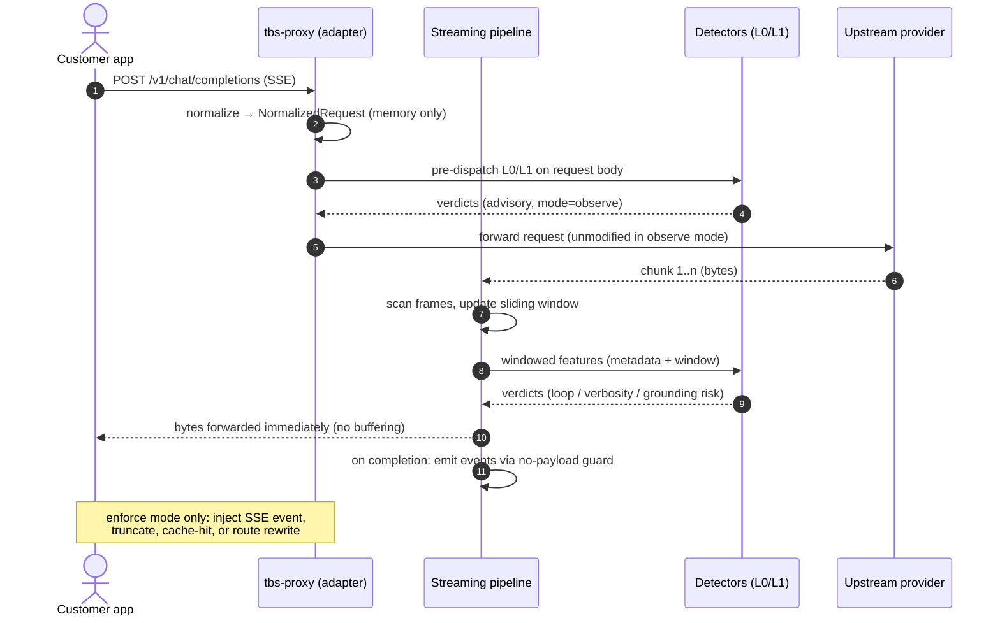

# 01 · System Overview

**Role of this doc**: C4 context + container diagrams, component inventory, and the explicit ANTI-GOALS that bound the design.

---

## 1. C4 — Context (system in its environment)

**Relationship summary**

| Neighbor | Direction | Protocol |
|---|---|---|
| Customer app | inbound | OpenAI-compatible / Anthropic / Google / Bedrock / Azure APIs, HTTP/1.1 + SSE |
| LLM providers | outbound | same, TLS 1.3 |
| OTel consumers (Langfuse, Datadog) | outbound | OTLP/gRPC or OTLP/HTTP |
| Metering/billing | outbound | REST webhook (OpenMeter-compatible events → Stripe) |
| Alerting | outbound | Slack webhook / PagerDuty Events API v2 / generic webhook |
| KMS | bidirectional | AWS KMS / GCP KMS / Vault transit (envelope crypto) |

---

## 2. C4 — Containers

### Component inventory

| Container | Responsibility (one paragraph) |
|---|---|
| **`tbs-proxy` — protocol adapters** | Terminates the customer's provider-shaped HTTP request, normalizes messages/tool schemas/usage into a single internal `NormalizedRequest` IR, and re-serializes to the target provider. Owns base-URL-swap, SDK-wrapper, and sidecar attachment modes, key custody (inject/censor `Authorization`), and provider quirks (Bedrock SigV4, Azure deployment paths, Anthropic `system` splitting). Must be pure passthrough when all policies are observe-mode. |
| **`tbs-proxy` — streaming pipeline** | Forwards response bytes chunk-by-chunk with bounded buffers: an incremental SSE/frame scanner feeds a sliding window to detectors while unmodified bytes flow straight to the client. Implements backpressure (paused upstream reads), TTFB budget, and mid-stream intervention primitives (inject SSE event, truncate with terminator, or abort). Never accumulates a full response. |
| **`tbs-proxy` — L0 detectors** | In-process heuristics at zero marginal cost: n-gram repetition/entropy, exact & near-dup hashes, regex structural bloat (stacktraces, base64, log floods), token estimates, loop counters over trajectory metadata. |
| **`tbs-proxy` — L1 detectors** | Embedded small models: quantized ONNX classifiers (verbosity, filler), local embedding model for similarity over sliding windows, MinHash/simhash for near-dup, routing-complexity scorer. Runs in-process or in the optional detection sidecar to bound p99. |
| **`tbs-proxy` — actuators** | Enforces decisions: semantic-cache hit injection, tool-output clamping/summarization, loop circuit-breaker (SSE interrupt), routing policy rewrite (model swap before dispatch), prompt-hygiene rewrite (off by default). Every actuation emits an audit event with before/after token counts. |
| **`tbs-proxy` — no-payload guard** | Architectural enforcement of zero-retention: a single choke point where event builders can only receive an allowlisted field set (ids, counts, hashes, latencies, verdicts). Typed so payload references cannot flow to any sink; sampled-trace export is a separate, explicitly opted-in path that passes the PII redactor first. |
| **L2 sampler** | Frontier-model checks (grounding verification, ambiguous loop disambiguation, intent clustering refinement) executed only on sampled/ambiguous cases, priced against the 3% intelligence budget, using **customer-supplied keys** in BYOC so payloads never hit our model accounts. Degrades off first when margin thins. |
| **`tbs-control` — API + console BFF** | Serves tenant onboarding, policy CRUD, rollout controls, receipts, and audit query. Stateless; all state in Postgres/ClickHouse. |
| **Policy service** | Compiles declarative YAML policies (see [04](04-actuation-layer.md)) into a signed, versioned snapshot distributed to proxies; enforces per-policy rollout percentage, modes, entitlements, and the global kill switch. |
| **Tenancy & entitlements** | Orgs → projects → api-keys model, RBAC roles, per-tier feature entitlements (which detectors/actuators a plan may enable), rate limits for L2 quota. |
| **Audit log writer** | Append-only record of every intervention decision (attempted, applied, suppressed, overridden) — the substrate for dispute resolution and the kill-switch forensics. |
| **PostgreSQL** | Source of truth for tenants, RBAC, policy snapshots, entitlements, audit metadata; Postgres-native encryption at rest + row-level security per tenant. |
| **ClickHouse** | High-volume event + ledger storage (detected waste, counterfactuals, attribution) — see [07](07-data-architecture.md) for justification. |
| **Redis** | Semantic-cache vector index (via HNSW set ops or embedded index), loop/trajectory session state, policy snapshot cache, rate-limit counters. Ephemeral by design — no payload at rest. |
| **Object store (opt-in)** | Only PII-redacted, explicitly sampled traces; off by default; separate KMS key; short retention (7/30 days by tier). |
| **OTLP exporter** | Streams metrics/log/trace events to customer-owned Langfuse/Datadog/Grafana — interop is a product feature, not a fallback. |
| **Billing & alerting webhooks** | Emits metering events (OpenMeter-class schema) and alert routes (Slack/PagerDuty/webhook). |

---

## 3. Request lifecycle (happy path, shadow mode)

---

## 4. ANTI-GOALS (what we deliberately do not build)

| Anti-goal | Why |
|---|---|
| **Dashboards-first observability** | Langfuse/Arize own per-call dashboards. We sell *prevention* priced on savings; a dashboard is a support tool, not the product. Our console shows receipts, policies, and rollout state — not trace explorers. |
| **Payload persistence** | Prompt/completion bytes never hit disk in the hot path (constraint #1). No dataset moat built on customer data. Opt-in sampled traces are redacted first. |
| **Training on customer data** | Non-starter for DPA/trust; also unnecessary — our intelligence layer uses small self-hosted models + customer-keyed L2 calls, not fine-tuned-on-tenant-data models. |
| **Hosting frontier models** | No inference platform, no GPU fleet. L2 is a thin, budgeted caller of the customer's own provider keys (or ours, strictly opt-in in SaaS mode). |
| **Replacing the customer's gateway/SDK** | Interop, not lock-in: OTel out to Langfuse/Datadog, standard wire protocols in, no proprietary SDK required for base-URL-swap mode. |
| **Generic prompt compression as the product** | LLMLingua-style compression is a *possible actuator*, not the differentiator. Our edge is trajectory-level governance + intent fingerprinting (see [COMPETETIVE_ANALYSIS](../COMPETETIVE_ANALYSIS.md)). |
| **Budget alerts as the primary control** | Reactive, post-hoc — the "2 AM email" the [manifesto](../PREVENTIVE_MANIFESTO.md) rejects. Budgets exist as a backstop actuator, not the pitch. |
| **Self-hosted model weights for L1** | Keep install footprint one binary + optional ONNX files; no PyTorch runtime, no model-serving stack in customer VPC beyond quantized files we ship. |

---

*Next: [02 — Data Plane](02-data-plane.md).*
