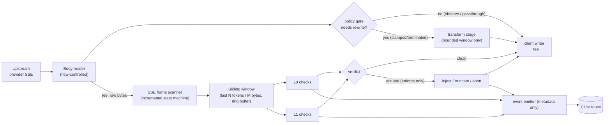

# 02 · Data Plane

**Role of this doc**: proxy attachment modes, supported protocols, the exact streaming passthrough mechanism, latency budget per hop, and failure-open vs failure-closed policy.

**Language choice: Rust** (tokio + hyper + rustls + bytes), one static binary `tbs-proxy`.

### Rust vs Go vs TypeScript

| Criterion | **Rust (chosen)** | Go | TypeScript (Node/Bun) |
|---|---|---|---|
| Bounded-memory streaming | `bytes::Bytes` zero-copy chains, explicit buffer ownership, no hidden copies | Good (bufio), but escape analysis + GC pressure at high churn | Buffers copy easily; `string` conversions tempt full-body buffering |
| Tail latency at p99 | No GC pauses; deterministic | GC pauses (improving, still a tail contributor) | Event-loop blocking on regex/JSON work; no isolates by default in proxy path |
| "One core binary" (BYOC/self-host) | Single static musl binary, tiny image (~15MB + ONNX) | Single binary (win) | Runtime + node_modules (contradicts single-binary topology) |
| SSE/internals control | Full control of chunk boundaries & backpressure | Full control | Control but weaker under load |
| LLM ecosystem fit | Must hand-roll provider serialization (fine: it's wire format) | same | Best (Vercel AI SDK, provider SDKs) |
| Hiring/iteration speed | Slowest | Fast | Fastest |
| Embedding L1 models | ONNX Runtime C API / `tract` native | cgo ONNX (painful) | onnxruntime-node (heavy runtime) |

**Defense**: the data plane's core promise is *sub-15ms p99 overhead with zero full-response buffering, forever, under agent traffic that spikes 10×*. That is a tail-latency + memory-ownership problem, not an iteration-speed problem. Rust buys: (a) no GC in the hot loop, (b) compile-time proof that payload buffers aren't cloned into logging sinks (ties directly to the zero-retention enforcement in [09](09-security-threat-model.md)), (c) one static binary for all three topologies. The iteration-speed penalty is mitigated because *only* the intelligence/policy semantics change often — and those live in data-driven policy snapshots and ONNX files, not in recompiled proxy code. TypeScript is rejected outright for bounded-memory passthrough at throughput; Go remains the credible fallback if Rust hiring stalls — the architecture isolates this decision behind the `NormalizedRequest` IR so the data plane is swappable (see [12](12-self-audit.md), assumption A-07).

Control plane (`tbs-control`) is **Go**: CRUD-heavy, fast to build, no tail-latency SLO. Detection sidecar logic reuses the same Rust crate.

---

## 1. Proxy attachment modes

| Mode | How it attaches | Customer change | Best for | Notes |
|---|---|---|---|---|
| **A. Transparent base-URL swap** (primary) | Point SDK `base_url` (OpenAI-compatible) / `endpoint` (Anthropic/Google) at `https://tbs.customer-edge.example` or VPC endpoint | One env var: `OPENAI_BASE_URL=…` (or provider equivalent) | Most teams, fastest adoption | Proxy rewrites Host + upstream URL; keys forwarded as-is or vaulted |
| **B. SDK wrapper** | `tbs` middleware wrapping official SDKs (Python/TS first) | `pip install tbs` + 2 lines | Teams wanting in-process L0 before serialization (cheapest: skips HTTP hop) | Must remain a thin adapter over the same policy engine; degrade = fall back to mode A |
| **C. Sidecar / transparent tunnel** | Per-pod sidecar (`tbs-proxy` container) or iptables/eBPF redirect in BYOC | Deployment manifest change | Enterprises with zero app-code change, service-mesh environments | Sidecar speaks native provider protocol, no interception magic required for v1; eBPF transparent mode deferred (see roadmap) |

All three modes run the **same core binary and policy engine** — mode only changes how bytes arrive. Topology (SaaS/BYOC/self-host) is orthogonal: see [08](08-deployment-topologies.md).

### Protocol support matrix

| Provider | Versions | Streaming | Tools/function-calling | Bedrock SigV4 | Notes |
|---|---|---|---|---|---|
| OpenAI-compatible | chat completions + responses API | SSE | ✅ | — | Also covers vLLM/Ollama/Mistral/Azure-compatible endpoints |
| Anthropic | Messages API 2023-06-01+ | SSE (`content_block_*` events) | ✅ | — | `system` param splitting preserved |
| Google | Gemini generateContent + streamGenerateContent | SSE/alt=sse | ✅ | — | |
| AWS Bedrock | converse / converse-stream | bidi stream | ✅ | ✅ | Credential injected from KMS envelope, never logged |
| Azure OpenAI | chat completions | SSE | ✅ | — | Deployment-scoped URLs, api-version passthrough |

**Normalization rule**: adapters produce one internal IR (`NormalizedRequest`) for detection, but **forward the original bytes** in observe mode — detection must never mutate the wire payload unless an actuator explicitly rewrites it.

---

## 2. Streaming passthrough mechanism (exact spec)

**Contract: never buffer a full response. Forward every received byte within one event-loop tick of arrival.**

### Mechanism components

1. **Flow-controlled body reader** — hyper `Body` stream polled with `poll_data`; **no aggregation** into a single `Vec`. Read high-water mark per connection: 64 KiB in flight; when the client is slow, upstream reads are paused (backpressure propagates to the provider) rather than accumulating in memory.
2. **Incremental SSE/frame scanner** — a zero-allocation state machine (`\n\n` event boundaries; `data:` line accumulation *only up to* a 256 KiB single-event cap; Anthropic `event:`/`data:` pairs; Bedrock prelude framing). Carries partial frames across chunk boundaries — chunk boundaries never equal event boundaries.
3. **Sliding window** — ring buffer over the **text content of the last 32 KiB (configurable) or last 8 messages-worth of deltas**, holding decoded text only for detector features; the raw bytes still flow untouched on the fast path. Window content is *memory-only* and dropped at stream end.
4. **Tee, not intercept** — detection consumes a branch of the stream; the writer branch is independent. Detection latency never sits in the byte-forward path except when a stage issues an actuation (see 4).
5. **Mid-stream actuation primitives** (enforce mode only):
   - **Inject**: emit an extra SSE event (e.g. `data: {"tbs":"loop_breaker",…}` + `finish_reason`) then normal `finish`, keeping stream syntactically valid.
   - **Truncate**: forward a valid terminator (`data: [DONE]` / `message_stop`) then close — client sees a completed stream, not an error.
   - **Abort**: RST/close on severe cases (protocol abuse, kill-switch tests) — reserved, audited, rare.
6. **Usage capture** — final `usage` chunk (or Bedrock final fields) parsed for actual token counts; feeds the ledger ([05](05-savings-ledger.md)). Missing usage → estimate via tokenizer table, flagged `estimated`.

### TTFB guarantee

Detector stages on the *request* path run before dispatch (L0 ≤ 1ms budget; L1 ≤ 6ms budget with pre-warmed model). The first response chunk is forwarded **before** any response-side detector completes; response detectors are inherently asynchronous to TTFB. Target: **TTFB delta < 10ms p99** — achieved because nothing in the first-chunk path waits on L1/L2.

---

## 3. Latency budget (per hop, p99)

| Hop / stage | Budget | Notes |
|---|---|---|
| Ingress accept + TLS session reuse | 1.0 ms | rustls, session tickets on |
| Protocol parse → `NormalizedRequest` | 1.5 ms | zero-copy where possible; 100k-token bodies are rare on request path |
| Key custody lookup / unwrap (cache hit) | 0.5 ms | L1 local cache; cache miss ≤ 5 ms (KMS) counted separately, async-warm |
| **L0 pre-dispatch detectors** | 1.0 ms | regex + hash + counters over request body |
| **L1 pre-dispatch detectors** | 6.0 ms | embedding + ONNX quantized; async if `pipeline=stream_start` policy allows |
| Policy snapshot read | 0.2 ms | in-memory `Arc<PolicySnapshot>`; refresh off-path |
| Upstream connection establish | excluded | connection pooling/prefetch to provider (kept warm) |
| Serialization + upstream write | 1.5 ms | |
| **First response chunk scan (warm)** | 0.5 ms | scanner amortized per chunk |
| Per-chunk detection (steady state) | ≤ 2 ms per chunk | off critical write path (tee) |
| Actuation decision → SSE inject (enforce) | 1.0 ms | only when tripped |
| **Total passthrough added overhead (no actuation)** | **< 15 ms p99** | sum of non-excluded rows ≈ 10.2 ms nominal + jitter margin |
| **TTFB delta on streams** | **< 10 ms p99** | request-side stages only |

Measurement method: synthetic client → tbs-proxy (observe mode, all detectors on) → recorded upstream replay; histogram via HDR, reported in CI perf gate (see [11](11-roadmap.md) NFRs).

---

## 4. Backpressure

| Mechanism | Spec |
|---|---|
| Bounded channels | `tokio::sync::mpsc` with capacity 16 chunks between scanner/detector tasks; `await` blocks the producer (detection falls behind → detector applies *sampling degradation*, never the forward path) |
| Client slow-read | writer `await` pauses upstream `Body` polling → TCP backpressure reaches provider; no unbounded queue anywhere in the pipeline |
| Detector overload policy | if detector queue > 80% for 5s: drop L2 first, then L1 sampling rate → 0.5 → 0.1, keep L0. **Forwarding never waits on detection** |
| Max memory per connection | 256 KiB ring + 64 KiB in-flight + ≤ 128 KiB scan buffers ⇒ hard cap ~512 KiB/conn; enforced by arena accounting; exceeding cap degrades detection, never buffers more |
| Slowloris / idle | idle timeouts: request 30s to first byte upstream, 120s inter-chunk (SSE keepalives excluded) |

---

## 5. Failure policy: failure-open vs failure-closed

Principle: **availability failures of US must not break the customer's traffic** (failure-open), **but policy/security failures must fail closed** (fail-closed). The savings claim depends on traffic flowing; the security claim depends on keys/payloads not leaking.

| Failure | Policy | Behavior | Rationale |
|---|---|---|---|
| Policy snapshot fetch failure | **open** | Use last-known snapshot; if none, observe-mode defaults | Losing governance ≠ dropping traffic |
| Policy service says "unknown tenant" (first-seen race) | **open, observe-only** | Allow traffic in observe mode, flag for reconciliation | Onboarding race must not 502 |
| Detection engine panic / sidecar down | **open** | Circuit-break the detector; passthrough + `detection_degraded` event | Detection is advisory by contract |
| L2 provider unreachable / budget exhausted | **open** (skip L2) | Degrade tiers per [03](03-detection-engine.md) §6 | L2 is sampling-only |
| Redis (semantic cache) down | **open** | Cache bypass (compute upstream) | Correctness unaffected |
| KMS unavailable & key not cached | **fail-closed for vaulted keys** | Reject request with `401 tbs_key_unavailable` — *unless* policy `key_fallback: passthrough` allows forward with client-presented key | Never send an unauthenticated/wrong key upstream |
| Secrets-format violation (key would be logged) | **fail-closed** | Drop log field, emit `secrets_redaction_failure` audit | Zero-retention is a hard constraint |
| Attempted payload egress to non-allowlisted sink | **fail-closed** | Compile/type-level deny (see [09](09-security-threat-model.md)); runtime guard panics the sink task, not the proxy | Architectural provability |
| Global kill switch engaged | **open → observe** | All actuators revert to observe; detection continues | Customer-controlled safety |
| Upstream provider error (5xx/timeout) | **open** | Propagate transparently; optional LLM-fallback routing only if enabled in policy | Provider failures aren't ours to mask by default |
| Quota exceeded (requests/min per tenant) | **fail-closed** | `429` with `Retry-After` | Standard API semantics; entitlements enforcement |
| Ledger/event store write failure | **open** | Queue in bounded disk spool *of metadata only* (no payloads), retry; if spool full, drop with `ledger_gap` event | Billing integrity degrades gracefully, never blocks inference |

**Audit**: every failure-path decision emits an audit event ([06](06-control-plane.md) §4); fail-closed branches always carry a customer-visible error code.

---

*Next: [03 — Detection Engine](03-detection-engine.md).*
