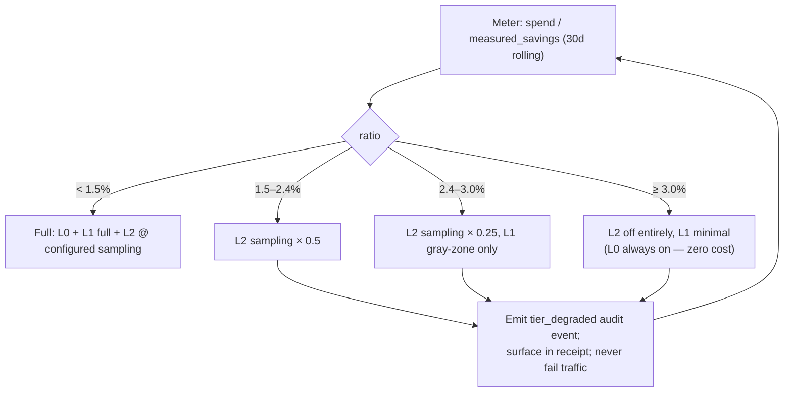

# 03 · Detection Engine

**Role of this doc**: one spec per detector — signal, algorithm, tier, cost estimate, precision/recall risk, available actuation — plus the tiered intelligence budget and degradation policy.

## 0. Tier definitions & budget rule

| Tier | What runs | Marginal cost | Latency budget |
|---|---|---|---|
| **L0** | Heuristics: regex, n-gram entropy, exact/near hashes (simhash), counters over trajectory metadata, token estimates | **$0** | ≤ 1 ms pre-dispatch / ≤ 2 ms per stream chunk |
| **L1** | Small local models: quantized ONNX classifiers, local embedding model (~40M params int8), MinHash-LSH | $0 marginal (CPU-ms only; amortized in unit economics, [10](10-unit-economics.md)) | ≤ 6 ms pre-dispatch, async on stream |
| **L2** | Frontier-model checks — grounding verification, ambiguous-loop disambiguation, intent clustering refinement | metered tokens | async only; never on critical path |

**Hard budget rule**: Σ(cost of L2 + our-CPU amortization) ≤ **3% of measured savings** over any rolling 30-day window (enforced per-tenant, see §6 degradation ladder + [10](10-unit-economics.md) §4).

**Modes**: every detector ships `observe` → `advise` → `enforce` with per-policy rollout % (see [04](04-actuation-layer.md)). Detection *runs* in all modes; only actuation differs.

**State model**: detectors consume two streams — (a) per-request `NormalizedRequest`/stream windows, (b) per-trajectory metadata sequence (`trajectory_id` = session/conversation id extracted from request metadata, in-memory sliding state, TTL 2h, **no payload persistence**).

---

## 1. Loop / repetition detection

| Field | Spec |
|---|---|
| **Waste class** | Infinite/near-infinite tool-call or clarification loops; "exploratory death loops"; same-error retry cascades — the multiplicative burn ([README problem §4](../../README.md)) |
| **Signals** | (i) n-gram repetition rate over streaming output deltas: fraction of 8-gram shingles already seen in window; (ii) exact-arg tool-call duplication over trajectory: `same(tool, canonical_json(args))` within K turns; (iii) embedding similarity of consecutive assistant turns (cos > τ); (iv) error-signature repetition (`exit≠0` + normalized stderr hash); (v) progress metric: distinct-state ratio = unique tool-args / total calls in window |
| **Algorithm** | **L0**: canonicalize args (sorted keys, drop volatile fields: timestamps, temp paths) → exact-hash set + simhash-64 near-dup (Hamming ≤ 3); sliding-window distinct-state ratio; output n-gram overlap via rolling hash ring (no full-text retention — ring holds hashes, not strings, after feature extraction). Trip: `identical_call ≥ 2 in 6 turns` OR `distinct_state_ratio < 0.3 over 8 calls` OR `error_signature ≥ 3 consecutive`. **L1**: int8 cross-encoder "is this turn a retry of previous turn?" over (prev, curr) *truncated* pairs (256 tok) — resolves benign repeats (user asked again) vs drift. **L2** (sampled/ambiguous only): frontier model classifies trajectory sketch (metadata + hash-sketched turns, or customer-key call with redacted window) as LOOP / PROGRESSING. |
| **Tier cost** | L0 ≈ 0.15 ms/turn · L1 ≈ 3 ms/turn (only when L0 score in gray zone 0.4–0.7) · L2 ≈ 400–1200 tokens @ ~1% of trajectories |
| **Precision/recall risk** | **FP risk**: legitimate retries (idempotent polling, flaky CI re-run), user-verbatim repeats, batch jobs calling same tool legitimately → mitigated by distinct-state ratio (counts distinct args) + L1 disambiguation + minimum-window guards; enforce mode requires 2 independent signals. **FN risk**: slow drift loops that mutate args every turn → embedding-similarity channel catches near-dup evolution; residual FN accepted in v1 (disclosed in [12](12-self-audit.md)) |
| **Actuation** | observe: score only · advise: annotate response + Slack digest · enforce: **loop circuit breaker** (inject SSE `loop_breaker` event + terminate stream with valid terminator; optionally rewrite next dispatch with corrective system nudge), retry-budget cap per trajectory |

*Continuity*: implements the production form of `guards/circuit_breaker.py` (identical-args, consecutive-error rules already exist in the CLI) — see [../ARCHITECTURE.md §3.4](../ARCHITECTURE.md).

---

## 2. Context-rot scoring

| Field | Spec |
|---|---|
| **Waste class** | Context dilution / "lost in the middle": stale instructions, duplicated content across turns, ungrounded retrieval flooding — waste that also *causes* downstream hallucination ([manifesto §2](../PREVENTIVE_MANIFESTO.md)) |
| **Signals** | (i) **staleness**: age & turn-distance of system-prompt sections and first-seen facts vs current turn; (ii) **duplication**: cross-turn near-dup blocks via MinHash-LSH over 5-line shingles (Jaccard ≥ 0.8) — repeated file dumps, re-pasted logs; (iii) **retrieval grounding**: fraction of retrieved chunks cited/overlapped by subsequent model output (embedding overlap); (iv) **context composition**: share of window that is tool noise vs instruction vs task; (v) structural bloat (from Phase-0 gate: stacktraces, base64, log floods) |
| **Algorithm** | **L0**: regex structural classes + MinHash (64 perms, banding) on message blocks → duplication map; instruction-age counters from trajectory metadata. Score `rot = w1·dup_frac + w2·stale_frac + w3·(1 − grounding_rate) + w4·noise_frac`, calibrated per tenant cohort. **L1**: local embedder for grounding/citation overlap where lexical fails; quantized regressor maps features → "rot severity" trained on labeled traces. **L2** (sampled): frontier judge: "given this context, how likely is the model to follow stale/conflicting instruction?" |
| **Tier cost** | L0 ≈ 0.5 ms/message-set (MinHash amortized) · L1 ≈ 4 ms per context assembly · L2 ≈ 800 tokens @ ~0.5% of requests |
| **Precision/recall risk** | **FP**: legitimately repetitive contexts (code re-sent every turn) — mitigated by treating *client-resend* vs *server-side* duplication differently and by advise-first rollout; **FN**: subtle contradiction between two non-duplicated sections → L2 sample only; acceptable (we score risk, not correctness) |
| **Actuation** | observe: rot score in ledger · advise: response annotation + per-feature rot trend · enforce (graduated): (a) **request-side**: drop exact-dup blocks, (b) **retrieve-side nudge**: emit `context_hygiene` advisory event to customer app, (c) hard cap `max_context_tokens` with rejection *only if* `reject_oversized: true` (default **false** — see [04](04-actuation-layer.md) prompt-hygiene caution) |

---

## 3. Over-fetch detection (tool outputs)

| Field | Spec |
|---|---|
| **Waste class** | Over-fetched tool outputs: 5k-token `ls -R`, full-file reads where 40 lines matter, unbounded `git log`/SQL dumps — then *re-transmitted every subsequent turn* (compound cost, [manifesto §2](../PREVENTIVE_MANIFESTO.md)) |
| **Signals** | (i) tool-result token size; (ii) **downstream reference rate**: fraction of output tokens actually quoted/grepped/embedding-referenced by later model turns (n-gram containment + embedding overlap); (iii) fetch-pattern norms (per tool, per tenant: p50/p95 size history); (iv) structure: line-count vs `max_results` respected, truncation markers present |
| **Algorithm** | **L0**: after tool result enters trajectory → record `(tool, size_tokens)`; over subsequent window compute `referenced_frac` via shingle containment of result lines in later turns (hash-based, no payload stored). Flag when `size > p95_norm(tool)` AND `referenced_frac < 0.15`. **L1**: embedder containment for paraphrased references (catches "the error mentioned above" cases where exact shingles fail); regressor for "fetch was necessary?" on gray-zone. **L2** (sampled): frontier judge on (tool spec + redacted excerpt metadata + reference summary) |
| **Tier cost** | L0 ≈ 0.05 ms per later turn (rolling containment) · L1 ≈ 3 ms only for flagged items · L2 ≈ 600 tokens @ ~0.5% |
| **Precision/recall risk** | **FP**: outputs referenced *implicitly* (model learned structure without quoting) → containment undercounts; mitigate: use embedding channel (L1) + only flag ≥ p95 sizes (large fetches are where money is). **FN**: over-fetch on *first* turn (nothing downstream yet to measure) → detected by size-vs-norm channel alone at lower confidence (`phase=prediction`); ledger classifies these as *projected* savings (see [05](05-savings-ledger.md)) |
| **Actuation** | observe: ledger event with size/reference metrics · advise: post-hoc receipt line "tool X: 4,200 tok fetched, 6% referenced" · enforce: **tool-output clamping** — pre-emptive size cap + head/tail + structure-aware prune before result enters trajectory (clamped amount recorded as prevented), and fetch-side request conditioning (`limit: 50` injection where schema supports it, off by default) |

---

## 4. Verbosity / filler classification

| Field | Spec |
|---|---|
| **Waste class** | Bloated system prompts & tool schemas (static, per-call tax) + verbose/filler model outputs |
| **Signals** | **Static**: schema/prompt token weight; redundant properties (`title`, restated descriptions, examples duplicating types); padding phrases ("Certainly! Let me walk you through…", boilerplate recaps). **Dynamic**: output filler ratio = tokens in discourse markers/hedging/restated-context classes; compression headroom = LLMLingua-style compressibility estimate |
| **Algorithm** | **L0**: structural lint on JSON-schema (port of `tools/schema_linter.py` — already ships in CLI: 40–60% schema reduction), phrase-class regex lexicon for filler, compression-headroom via token-dropping simulation with importance scores (cheap logistic on unigram IDF). **L1**: int8 classifier per 128-token block (filler vs informative) on output; quantized seq-level compressibility scorer. **L2**: almost never — reserved for rewriting *examples* in advise mode (customer-keyed) |
| **Tier cost** | L0 ≈ 0.2 ms static / ≤ 1 ms per 1k output tokens · L1 ≈ 2 ms per 512-token block · L2 ≈ ~1.5k tokens only for generated rewrite suggestions (opt-in) |
| **Precision/recall risk** | **FP**: filler lexicon hits code comments, legal-ish text, deliberate explanations ("as you asked…") → code-fence exclusion + only advise on outputs, never silent rewrite; **FN**: verbose-but-useful → accepted: we optimize *filler*, not style |
| **Actuation** | observe: verbosity score + headroom estimate in ledger · advise: suggest schema minification diff (static) / show compressible output fraction · enforce: **static schema minification at dispatch** (safe — mechanical, loss-tested) ; dynamic output compression only as *future* opt-in actuator (not v1: mutates user-visible bytes, see anti-goal "prompt rewrites off by default") |

---

## 5. Hallucination-risk grounding checks

| Field | Spec |
|---|---|
| **Waste class** | Ungrounded generations → rework loops, wrong-code burn (the most expensive class per incident) |
| **Signals** | (i) claims with no overlap to provided context (numeric/entity assertions); (ii) citations/file-paths/tool-mentions in output not present in trajectory; (iii) internal contradiction markers; (iv) retrieval chunks never referenced (dead weight) |
| **Algorithm** | **L0**: extract verifiable atoms (file paths, `usr:` refs, numbers with units, function names) via regex/grammar → membership check against trajectory hash-set (zero cost). **L1**: NLI-style int8 entailment (premise=context windows, hypothesis=claim sentences, truncated) for overlap-free claims; local embedder for soft grounding. **L2**: frontier groundedness judge on sampled output (customer key in BYOC; see key-custody §[09](09-security-threat-model.md)); structured verdict JSON |
| **Tier cost** | L0 ≈ 0.1 ms · L1 ≈ 5 ms per claim-cluster (async) · L2 ≈ 1k tokens @ 1–2% sampling (budget-gated) |
| **Precision/recall risk** | **FP**: valid world-knowledge claims (not in context but true) → severity must be *risk*, not verdict: score = unsupported-claim density + domain sensitivity (code/numbers weigh higher); enforce never blocks on this detector alone in v1 (advise + ledger only). **FN**: fluent subtle hallucinations → L2 sample; we do **not** claim detection completeness (self-audit [12](12-self-audit.md)) |
| **Actuation** | observe: groundedness score in ledger (per-feature) · advise: annotate response with `grounding: N unsupported atoms` · enforce (Phase 2+, opt-in): quarantine-and-verify (re-run claim verification before forward) — default **off** |

---

## 6. Routing advisor (task complexity → model tier)

| Field | Spec |
|---|---|
| **Waste class** | Frontier-model-for-everything routing tax (competitor gap: LiteLLM reacts; we classify *intent before spend*, [COMPETETIVE_ANALYSIS](../COMPETETIVE_ANALYSIS.md)) |
| **Signals** | request-only features: token counts by section; tool-count & schema complexity; presence of code-diff/stacktrace/math markers; conversation depth; historical per-(intent-cluster, model) outcome stats (success/length/retry); tenant-declared model pricing table |
| **Algorithm** | **L0**: rule band (short summarization/extraction/classification intents → cheap tier; regex task taxonomy). **L1**: int8 complexity classifier over (task intent embedding, structural features) → {cheap, mid, frontier} with calibrated confidence; confidence < 0.85 → defer. **L2**: sampled frontier-vs-cheap A/B judge on outcome quality (offline, feeds L1 labels — **not** per-request). Outcome feedback loop: retry/failure rates per (cluster, model) retrain weights weekly (self-hosted, non-tenant-crossing aggregate or per-tenant if opted) |
| **Tier cost** | L0 ≈ 0.05 ms · L1 ≈ 2 ms (runs pre-dispatch, can overlap L0) · L2: offline labeling only — no per-request charge (counted as infra in [10](10-unit-economics.md)) |
| **Precision/recall risk** | **FP (downgrade when frontier needed)** → quality regression = churn risk. Mitigations: confidence gating, `enforce` requires ≥ 97% calibration on tenant replay set, per-tenant allowlist of downgrade pairs, holdout 10% traffic in Phase 2, immediate kill switch. **FN (upgrades missed)** → lost savings, no harm — safe direction |
| **Actuation** | observe: counterfactual model suggestion ("gpt-4o → 4o-mini would save $X") in ledger · advise: header back to app (`x-tbs-suggested-model`) · enforce: **rewrite `model` field pre-dispatch** with audit entry (before/after price), only for allowlisted downgrade pairs |

---

## 7. Intent fingerprinting (feature-level cost attribution)

| Field | Spec |
|---|---|
| **Waste class** | *Attribution*, not prevention directly — answers "which feature burns the budget" (Langfuse's gap: per-call, not per-feature; our stated differentiator) |
| **Signals** | system-prompt hash + template skeleton (mask literals), tool-selection vector, first-user-message embedding, endpoint/route headers, app-provided labels (`x-tbs-feature` when present — highest fidelity), trajectory shape (turn/tool counts) |
| **Algorithm** | **L0**: template skeletonization (replace numbers/uuids/paths) → hash bucket; explicit header/label capture (always preferred when customers adopt it). **L1**: embedding of skeletonized first-turn + tool-vector → online clustering (fresh-classified-incremental / spherical k-means over rolling 30d, per-tenant); stability via centroid anchoring; cluster → `intent_cluster_id`. **L2** (batch, sampled): frontier naming/tagging of clusters ("signup-flow-retry") for human-readable receipts — customer-keyed, off by default, budget-metered. Feedback: console lets users rename/merge clusters (precision amplifier, human-in-loop) |
| **Tier cost** | L0 ≈ 0.02 ms · L1 ≈ 2 ms embedding + async clustering (amortized ≪1 ms/req) · L2 batch ≈ 500 tokens/cluster/week @ typical 50–200 clusters |
| **Precision/recall risk** | **FP**: clusters merge distinct features → cost misattributed; mitigated by explicit-label-first hierarchy (`label > hash > embedding cluster`) and merge/split UI. **FN**: one feature spread over many clusters → silhouette monitoring + auto-flag low-stability clusters as `attribution: uncertain` in receipts. Attribution events carry confidence + method so CFO receipts never overstate precision |
| **Actuation** | No traffic mutation. Output: `intent_cluster_id`, `feature_label` on every ledger event → per-feature savings/cost rollups ([05](05-savings-ledger.md)), budget alerts *per feature*, routing advisories per cluster |

---

## 8. Detector summary matrix

| # | Detector | L0 | L1 | L2 | Primary actuator (enforce) | Ships in |
|---|---|---|---|---|---|---|
| D1 | Loop/repetition | ✅ core | ✅ gray-zone | sampled | circuit breaker | **Phase 0** |
| D2 | Context rot | ✅ core | ✅ scoring | sampled | dup-drop (advisory→strict) | **Phase 0** (score), Phase 1 (actuate) |
| D3 | Over-fetch | ✅ core | containment | sampled | tool-output clamping | **Phase 0** (detect), Phase 1 (clamp) |
| D4 | Verbosity/filler | ✅ core | block classifier | opt-in rewrite | schema minification | **Phase 0** (static), Phase 2 (dynamic) |
| D5 | Hallucination risk | ✅ atoms | NLI | sampled judge | quarantine (opt-in, off) | Phase 0 (score), Phase 2 (actuate) |
| D6 | Routing advisor | ✅ rules | classifier | offline labels only | model rewrite | **Phase 2** |
| D7 | Intent fingerprint | ✅ skeleton | clustering | batch naming | (attribution only) | **Phase 2** |

---

## 9. Tiered-budget enforcement & degradation ladder

Per-tenant 30-day rolling meter: `intelligence_spend ≤ 0.03 × measured_savings` (ledger events of class `measured`, [05](05-savings-ledger.md)).

| Rule | Value |
|---|---|
| L0 availability | **never degraded** (zero marginal cost) |
| Degradation direction | L2 → L1 → L0 only; never adds spend under pressure |
| Cold-start / low-savings tenants | absolute L2 monthly cap (e.g. $25 starter) *in addition* to 3% ratio — ratio alone is meaningless at ~zero savings |
| Recovery | automatic when ratio falls below threshold for 7d; hysteresis prevents oscillation |
| Transparency | every degradation emits `tier_degraded` audit event; shown on receipt as `intelligence_budget_utilization` |

---

*Next: [04 — Actuation Layer](04-actuation-layer.md).*
