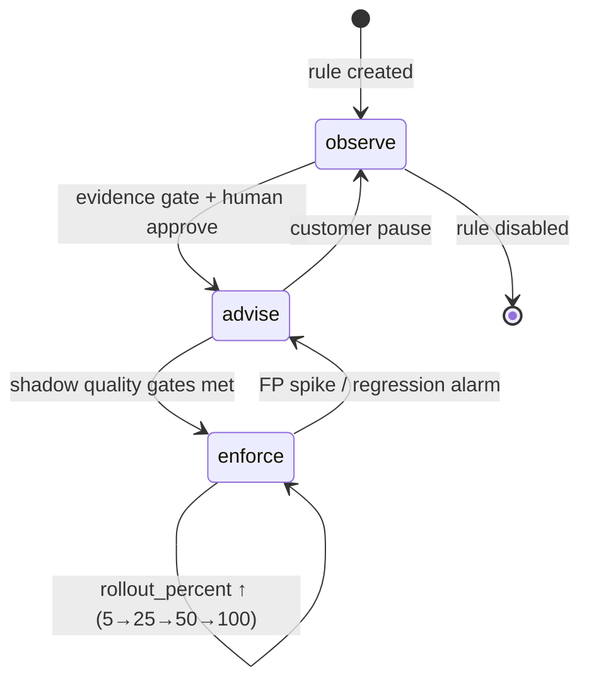

# 04 · Actuation Layer

**Role of this doc**: the actuators we ship, why prompt-hygiene rewrites are off by default, the declarative policy schema, and graduated rollout semantics.

**Design rule**: detection may run always; **mutation of customer traffic requires (a) enforce mode, (b) positive rollout lottery, (c) entitlement, (d) audit write** — four gates on one code path.

---

## 1. Actuators

### 1.1 Semantic cache injection

| Aspect | Spec |
|---|---|
| **What** | On cache hit, serve stored completion instead of upstream call; upstream never invoked → cost prevented = full request cost |
| **Lookup key** | Embedding of normalized request (system + last user turn, tools fingerprint, model, params) → cosine ≥ τ (default 0.94, per-tenant tunable) via Redis HNSW set; exact-hash fast path first |
| **Eligibility gates** | `temperature ≤ 0.7`; **no** user-specific PII markers detected by L0 redactor-pass (hit must be safe to serve cross-request); streaming supported by replaying stored delta chunks at 5ms cadence (re-chunked, bounded buffer: stored *completion* lives in Redis **memory only**, encrypted at rest if persistence enabled — opt-in, because completion content at rest is a payload-class datum: default `cache.persistence = off`, cold-start only, documented in receipts as `cache_mode: ephemeral`) |
| **Freshness** | TTL per tenant (default 10 min), invalidated by policy bump or model version change |
| **Actuation modes** | observe: log would-be-hit + `$` · advise: serve but header `x-tbs-cache: hit-advised`?? → **no**: advise logs only; serve only in enforce (differs from other actuators: false cache hits are quality risks, so observe→advise→enforce still holds but "advise" means *shadow-score the would-be hit* against a sampled real response for hit-quality measurement) |
| **Savings accounting** | **measured**: counterfactual = actual upstream price table for that request; evidence = would-be-hit proven by parallel shadow sampling 1–2% (verify stored vs fresh equality), rest classified projected until shadow confirms → see [05](05-savings-ledger.md) |
| **Composed OSS** | GPTCache/RedisVL-style vector index pattern — we own eligibility + accounting, compose the index |

### 1.2 Tool-output clamping / summarization

| Aspect | Spec |
|---|---|
| **What** | Cap tool results entering the trajectory: (a) mechanical clamp — head/tail + dedupe + structure-aware prune (stacktrace tail, log-level filter); (b) summarize-first — small local model (or L1 extractive) replaces body with N-token digest + full output *dropped* (not stored — clamped bytes are discarded, so downstream re-fetch is the recovery path) |
| **Trigger** | `size_tokens > per-tool cap` OR over-fetch detector (D3) enforce verdict |
| **Defaults** | cap 2,000 tok/tool-call (configurable per tool in policy YAML); **mechanical clamp default on in enforce; summarization default off** (model-generated digest can lose the critical line → require opt-in + sampled verification first) |
| **Accounting** | prevented = (original − clamped) × price × **resend multiplier** (number of subsequent turns that would have re-carried it; measured from actual trajectory when clamp occurs on turn t: observed trajectory carries clamp-forward savings naturally) |
| **Failure** | clamp errors → fail-open (pass through, log `clamp_failed`) |

### 1.3 Loop circuit breaker

| Aspect | Spec |
|---|---|
| **What** | On D1 enforce verdict: terminate current stream (valid SSE terminator + optional `loop_breaker` event carrying reason + trajectory stats), and/or cut trajectory retry budget (`max_consecutive_same_tool`, `max_identical_args`, `max_consecutive_errors` — the Phase-0 rules from [../ARCHITECTURE.md §3.4](../ARCHITECTURE.md), promoted to server-side) |
| **Graduation** | trip-level 1: annotate only · level 2: inject corrective system nudge into next dispatch (off by default — it mutates prompt) · level 3: hard terminate · level 4: + trajectory cooldown (requests in trajectory answered with structured error the app can catch) |
| **Guardrails** | never trips in observe; enforce requires 2 signals (see D1 FP analysis); per-trajectory trip counter with 60s refractory window; kill switch instant |
| **Accounting** | **projected** class by default: prevented = observed burn-rate × expected remaining loop horizon (capped at 3× last-10-turn burn, disclosed methodology) — some tenants opt into `measured` counting via canary: allow loop to run on 2% canary cohort (opt-in, capped $) to ground the projection |

### 1.4 Routing policy engine

| Aspect | Spec |
|---|---|
| **What** | Pre-dispatch `model` field rewrite per D6 verdict + policy allowlist (e.g. `gpt-4o → gpt-4o-mini` for `intent_cluster = classification`) |
| **Safety** | downgrade pairs explicitly enumerated in policy (never free-form); confidence gate ≥ calibrated τ; per-feature opt-out; 10% holdout keeps original route for counterfactual quality measurement (feed back to advisor) |
| **Accounting** | **measured**: same request, two prices — exact (frontier price − routed price) × actual tokens; strongest savings class in the ledger |
| **Fail** | no matching pair / low confidence → original model (fail-open) |

### 1.5 Prompt-hygiene rewrites — **off by default, justification**

Rewrites here mean: LLMLingua-style context compression at dispatch, dedupe-drop of "stale" context blocks, instruction restatement — anything that **changes what the model sees without the app knowing**.

Why default-off (policy key `hygiene.rewrite: false`):

1. **Counterfactual auditability**: our CFO-grade ledger must reconstruct "what would this have cost unmodified." Rewrites make the counterfactual chain two edits deep (rewrite + provider call); cache and routing have clean single-edit counterfactuals — hygiene does not.
2. **Blast radius**: dropping a block a *human* believed was delivered can cause silent quality regressions that surface days later (D2 FP risk: "legitimately repetitive" context). Loop-breaker false positives are loud and immediately reversible; hygiene FPs are quiet and sticky.
3. **Competence overlap**: LLMLingua already owns compression; our differentiation is trajectory governance + attribution ([COMPETETIVE_ANALYSIS](../COMPETETIVE_ANALYSIS.md)). We *integrate* compression as an optional actuator rather than compete on it.
4. **Enterprise trust**: "we modify your prompts" is a harder DPA conversation than "we cache, clamp tool outputs, stop loops, reroute models."

Allowed in v1: **static schema minification** (mechanical, loss-tested by CI diff harness), mechanical tool-output clamp. Hygiene rewrites ship Phase 2+ as `hygiene.rewrite: true` with mandatory advise-period ≥ 14d and shadow-diff receipts.

---

## 2. Declarative policy schema (YAML)

Policy compiles to signed versioned snapshot distributed to proxies ([06](06-control-plane.md) §3).

```yaml
# tbs-policy.yaml — versioned per project
apiVersion: tbs.dev/v1
kind: Policy
metadata:
  project: prod-agents
  revision: 41
spec:
  # ---- global safety ----
  mode: advise                # observe | advise | enforce  (project floor)
  kill_switch: false          # true ⇒ force observe everywhere, instantly
  failure_policy:
    detection: fail-open
    keystore: fail-closed     # vaulted keys: refuse rather than mis-auth

  # ---- detector / actuator pairs ----
  rules:
    - id: loop-breaker
      detector: loop_repetition      # D1
      actuator: circuit_breaker
      mode: enforce                  # must be <= project floor
      rollout_percent: 25            # per-request lottery, sticky by trajectory
      params:
        max_identical_args: 1
        max_consecutive_errors: 3
        min_window: 3
        trip_level: 3                # 1 annotate, 2 +nudge, 3 terminate
      thresholds:
        gray_zone: [0.4, 0.7]        # L1 only inside this band

    - id: clamp-tool-outputs
      detector: over_fetch           # D3
      actuator: tool_output_clamp
      mode: advise                   # advise = log would-clamp, pass through
      rollout_percent: 100
      params:
        default_cap_tokens: 2000
        strategy: head_tail_dedupe   # head_tail_dedupe | summarize | off
        per_tool:
          read_file: { cap: 1200 }
          search:    { cap: 800, max_results: 50 }

    - id: route-classification
      detector: routing_advisor      # D6
      actuator: model_rewrite
      mode: observe
      rollout_percent: 10            # holdout accounting built-in
      params:
        pairs:
          - from: gpt-4o
            to: gpt-4o-mini
            when_intent: [intent_cluster:in:classification, extraction]
            min_confidence: 0.9

    - id: semantic-cache
      detector: request_fingerprint
      actuator: semantic_cache
      mode: enforce
      rollout_percent: 100
      params:
        similarity: 0.94
        ttl_seconds: 600
        max_temperature: 0.7
        persistence: off             # ephemeral cache; see 04 §1.1

    - id: hygiene-rewrites
      detector: context_rot          # D2
      actuator: prompt_hygiene       # shipped Phase 2
      mode: observe                  # default OFF: see §1.5
      rollout_percent: 0
      params: { rewrite: false, dedupe_blocks: false }

  # ---- intelligence budget ----
  intelligence_budget:
    max_ratio: 0.03            # spend / measured_savings, 30d rolling
    l2_sampling: 0.01          # base sampling rate
    absolute_monthly_cap_usd: 25
    degrade_ladder: default    # L2 → L1 → L0, see 03 §9

  # ---- attribution ----
  attribution:
    feature_header: x-tbs-feature   # explicit label preferred
    cluster_refresh_hours: 24
    report_uncertain: true          # low-confidence clusters flagged

  # ---- export ----
  export:
    otlp_endpoint: "https://otel.customer.example:4317"
    billing_events: true
```

**Schema invariants** (validated at compile; violations rejected, not warn):

1. `rule.mode ≤ metadata.floor mode` ordering: `observe < advise < enforce`.
2. Any `enforce` rule requires `rollout_percent` explicitly (no silent 100).
3. `kill_switch: true` overrides everything → effective mode = observe.
4. Actuator `prompt_hygiene` requires `rollout_percent: 0` unless phase ≥ 2 gate flag set.
5. `model_rewrite.pairs` must be enumerated; wildcard rewrites rejected.

---

## 3. Graduated rollout semantics



| Stage | Traffic mutation | Entry requirement | Exit evidence |
|---|---|---|---|
| **observe** | none | default for every new rule | ≥ 7d data OR ≥ 10k requests: precision estimate on labeled/sampled set; receipt shows would-have-saved |
| **advise** | annotations only (`x-tbs-*` headers, SSE advisory events, receipt lines) | observe precision ≥ target (default 0.9 for breaker, 0.95 for clamp) | no adverse customer signal; advise→outcome correlation logged |
| **enforce** | real mutation at `rollout_percent` | advise stage passed + **per-rule human approve** + entitlement | FP rate within band per 1k enforced; automatic rollback on breach |

**Rollout mechanics**

- **Lottery**: deterministic hash on `trajectory_id + rule_id` → uniform percent; sticky per trajectory (mid-trajectory mode flips cause incoherent sessions).
- **Percent changes**: applied at policy snapshot boundaries (≤ 30s propagation, p99 ≤ 5s via push); monotonic increase requires approval, decrease is instant.
- **Kill switches** (3 levels): (1) rule off, (2) project → observe, (3) global (all tenants → observe, triggered by us, surfaced in status page) — all three append immutable audit entries with actor + timestamp.
- **Per-rule audit event**: `{ts, tenant, rule, revision, mode, rollout_bucket, verdict, action_taken, would_act, tokens_before, tokens_after, $counterfactual, actor}` — one event per decision, enforced (see [07](07-data-architecture.md) schema).

---

*Next: [05 — Savings Ledger](05-savings-ledger.md).*
