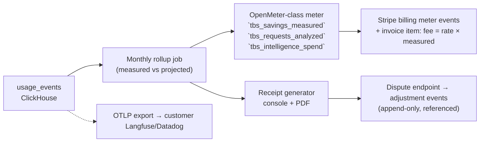

# 05 · Savings Ledger

**Role of this doc**: the event model, the counterfactual formula (with worked example), per-feature attribution, the customer-facing savings receipt, and billing/metering integration. This ledger is a **first-class product feature** — the sales conversation is "watch your bill shrink," so the arithmetic must survive a CFO's audit (see [COMPETETIVE_ANALYSIS](../COMPETETIVE_ANALYSIS.md) §Business Model).

## 1. Design principles

1. **Every prevented-dollar has an event, an estimator class, and an evidence pointer.** No manual adjustments.
2. **Two estimator classes, never mixed in headline numbers**:
   - `measured` — the counterfactual is *observed*: e.g., a cache hit verified by shadow re-execution, a routing rewrite where both prices are known for the same token counts, a clamp where actual carried-forward savings are observed in the real trajectory.
   - `projected` — the counterfactual is *modeled* (loop termination horizon, un-run hypotheticals). Disclosed, aggregated separately, **excluded from the billable figure by default**.
3. **Price source of truth**: customer-supplied price table (per model, per token class) with provider-list defaults; versioned — price changes never retroactively alter closed ledger periods.
4. **Savings are attribution-neutral**: an event without `intent_cluster_id` still counts; attribution enriches, never gates, the arithmetic.
5. **Idempotent & replayable**: event keys are content-addressed (`event_id = sha256(...)`); replaying the stream reproduces identical ledger totals (dispute tooling depends on it).

---

## 2. Event model

One event type for everything that costs or saves — `usage_event` — with a `kind` discriminator (schema detail in [07](07-data-architecture.md)):

```jsonc
{
  "event_id": "sha256:…",             // content-addressed, idempotency key
  "ts": "2026-10-15T12:00:00.123Z",
  "tenant_id": "org_123",
  "project_id": "proj_prod_agents",
  "trajectory_id": "traj_abc",         // session/conversation linkage
  "request_id": "req_xyz",
  "kind": "prevented",                 // actual | prevented | intelligence_spend | adjustment

  // --- what actually happened ---
  "actual": {
    "model": "gpt-4o-mini",
    "input_tokens": 1800, "output_tokens": 340,
    "cache_read_tokens": 0,
    "cost_usd": 0.00148,               // from price table, versioned
    "price_table_v": 7
  },

  // --- what would have happened (counterfactual) ---
  "counterfactual": {
    "model": "gpt-4o",
    "input_tokens": 4200,              // e.g. clamped 2400 tool tokens absent
    "output_tokens": 340,
    "cost_usd": 0.0487,
    "estimator": "measured",           // measured | projected
    "method": "route_rewrite_same_tokens", // which formula branch, see §3
    "evidence": {                      // pointer, not payload
      "shadow_sample_id": "sh_9f2…",   // measured cache/route verification
      "window": "last_10_turns_burn"   // or projection basis
    }
  },

  // --- prevention metadata ---
  "rule": { "id": "route-classification", "rev": 41, "mode": "enforce", "actuator": "model_rewrite" },
  "prevented_usd": 0.04722,            // = cf.cost - actual.cost, computed at write
  "confidence": 0.97,                  // estimator confidence, see §3.4
  "attrib": { "method": "embedding_cluster", "intent_cluster_id": "ic_17",
              "feature_label": "document-qa", "label_source": "header" },
  "latency_ms": 812
}
```

**Event kinds**

| kind | Meaning | Aggregates into |
|---|---|---|
| `actual` | Request happened; cost incurred (even if un-prevented) | spend baseline, ROI denominators |
| `prevented` | Actuator changed outcome; carries `actual` + `counterfactual` | **savings ledger** (measured / projected subtotals) |
| `intelligence_spend` | Our L2/model cost + amortized L1 CPU for this tenant-window | 3% budget meter ([03](03-detection-engine.md) §9, [10](10-unit-economics.md)) |
| `adjustment` | Dispute resolution / clawback; references original `event_id`; append-only | reconciled ledger (never mutates history) |

---

## 3. Counterfactual formula (the methodology)

### 3.1 Master formula

For every request `r` where an actuator intervened:

```
prevented(r) = C_cf(r) − C_actual(r)
```

where `C_actual` is computed from *what the provider actually reported* (usage fields; tokenizer estimate flagged `estimated` if absent) × tenant price table, and `C_cf` is computed by **branch**, chosen by `method`:

| Method (actuator) | `C_cf` definition | Class | Why this is defensible |
|---|---|---|---|
| `cache_hit` | `price(model, tokens_in_cf, tokens_out_cf)` where cf token counts = the request as would have been sent (same input; output = stored completion length) | **measured**, once shadow-verified | Both sides are real observations (shadow re-executes un-cached path at ≤2% sampling); equality tolerance ±1% output tokens or flagged |
| `route_rewrite` | `price(model_from, same_input_tokens, same_output_tokens)` vs `price(model_to, …)` | **measured** | Identical token counts, two list prices — arithmetic, not estimation |
| `tool_clamp` | `price(model, input_tokens + clamped_tokens × resend_mult, out)` where `resend_mult` = number of *subsequent turns in the same trajectory that actually re-sent* the unclamped block (measured post-hoc from the real trajectory: clamp removes block → later turns carry `−N` input tokens observed) | **measured** for observed window; **projected** for remaining turns beyond observation | Resend multiplier is read from actual token-count deltas in subsequent turns — observable once ≥1 post-clamp turn occurs |
| `circuit_breaker` | `C_cf = burn_rate × expected_remaining_horizon`, where `burn_rate` = mean $/min over the loop's last 10 turns, `horizon` = min(configured cap: 3× burn of prior 10 turns, time-to-natural-end observed in shadow canary if available) | **projected** (default) | Termination makes the future unobservable; horizon is a documented upper-bound model, disclosed on receipt; tenants may opt into canary-measured grounding (see [04](04-actuation-layer.md) §1.3) |
| `verbosity_schema_minify` | token deltas × price, recomputed each dispatch (static schema difference is directly countable per call) | **measured** | Byte-count difference, zero estimation |
| `over_fetch_flag` (observe/advise only) | hypothetical clamped cost under cap policy | **projected** | No mutation occurred; presented as "opportunity," never billed |

**Billable savings** (default, per contract tier):

```
billable_savings(30d) = Σ prevented(r)  WHERE estimator = measured
potential_savings(30d) = billable_savings + Σ prevented(r) WHERE estimator = projected
```

Our fee = `contract_rate × billable_savings` (rate configurable per tier; see receipt §5). Projected savings are marketing/pipeline value, shown but un-invoiced unless a tenant opts into `projected_billing: true` with signed methodology acknowledgment.

### 3.2 Worked example (single trajectory, one day)

Context: tenant price table v7 — `gpt-4o`: $2.50/M in, $10.00/M out; `gpt-4o-mini`: $0.15/M in, $0.60/M out.

**Turn 1 — routing rewrite (measured)**: request would have used `gpt-4o`; actuator rewrote to `gpt-4o-mini` (identical token counts, two list prices):

```
actual   (mini): 4,200 × $0.15e-6 + 610 × $0.60e-6 = $0.00063 + $0.000366 = $0.000996
cf       (4o)  : 4,200 × $2.50e-6 + 610 × $10.00e-6 = $0.01050 + $0.00610  = $0.016600
prevented     = $0.016600 − $0.000996 = $0.015604   (estimator: measured, method: route_rewrite)
```

**Turn 2 — tool clamp (measured)**

A `search` tool returns 5,000 tokens; policy cap 800 → clamp drops 4,200 tokens *before they enter the trajectory*.

```
actual   : input 1,050 tok (post-clamp request) 
cf       : input 1,050 + 4,200 = 5,250 tok, same model (4o-mini @ $0.15/M in)
per-turn prevented = 4,200 × $0.15e-6 = $0.00063
resend_mult: the trajectory's next 3 turns each re-send full history;
  observed input deltas (1,050 vs cf 5,250) confirm 3 resends
measured window prevented = $0.00063 × (1 + 3) = $0.00252
```

**Turns 3–11 — loop breaker (projected)**

Loop detected at t=11: same `read_file` with identical args, 6 consecutive. Observed `burn_rate` last 10 turns = $0.042/turn. Cap rule: `horizon = min(3 × prior-10-turn burn = 3 × $0.42 = $1.26, modeled natural end estimate $0.55)`.

```
cf       = 6 × $0.042 = $0.252  (6 more identical turns at observed rate, horizon model)
actual   = $0.00000 (terminated; no further spend)
prevented = $0.252   (estimator: PROJECTED — excluded from billable)
```

**Day totals**

| Class | Amount |
|---|---|
| measured (billable) | $0.015604 + $0.00252 = **$0.018124** |
| projected (disclosed) | $0.252000 |
| intelligence spend (L2, this trajectory) | $0.00040 (`intelligence_spend` event) |
| ratio | 0.00040 / 0.018124 = **2.2% ≤ 3% ✓** (ladder would trim next tier-up sampling) |

### 3.3 What we refuse to count (anti-inflation rules)

- Savings vs. a fictional "worst-case model" — cf baseline must be the model *the request would actually have used* (read from pre-rewrite field, or policy default when unset; never "if they'd used the most expensive model").
- Double counting clamp + cache on same tokens (event ledger keys include `causal_parent` — cache hits can't claim savings already claimed by clamp in same trajectory-window).
- Savings on requests that never occurred (no "you would have looped forever" beyond horizon cap).
- Retroactive re-pricing of closed periods.

### 3.4 Confidence

`confidence = f(estimator_class, shadow_sample_rate, sample_agreement)`. Receipt displays distribution (e.g., "92% of measured savings from >30-sample methods"). Projected items carry method name + horizon rule inline.

---

## 4. Per-feature attribution rollup

```sql
-- ClickHouse materialized view (sketch)
SELECT
  tenant_id,
  attrib.intent_cluster_id,
  any(attrib.feature_label),
  sumIf(prevented_usd, estimator = 'measured') AS measured_savings,
  sumIf(prevented_usd, estimator = 'projected') AS projected_savings,
  sumIf(actual.cost_usd, kind = 'actual')       AS actual_spend,
  count() AS requests,
  any(attrib.method) AS attribution_method
FROM usage_events
WHERE ts >= now() - INTERVAL 30 DAY
GROUP BY tenant_id, attrib.intent_cluster_id;
```

Rollups power: receipt table, per-feature budget alerts ([06](06-control-plane.md) §5), routing-advisor ROI ([03](03-detection-engine.md) D6), and the console's *feature ledger* (not a trace dashboard — a **cost-by-intent table**, deliberately different from Langfuse).

Attribution methods ladder (fidelity desc.): `explicit_header > template_hash > embedding_cluster`; every row records which applied — uncertain clusters render as `uncertain (62% conf)` rather than silently precise.

---

## 5. Savings receipt (customer-facing)

Rendered monthly in console + PDF/CSV export; also the invoice attachment.

```markdown
# Token Bleed Shield — Savings Receipt
Tenant: Acme Corp · Period: 2026-10-01 → 2026-10-31 · Price table v7 · Policy rev 41

## Headline
  Measured savings (billable) .......... $4,182.60
  Projected savings (disclosed) ........ $1,933.44   ← not invoiced
  Your spend without TBS (measured+cf) . $18,940.22
  Your actual spend .................... $14,757.62
  Intelligence spend (our cost) ........ $96.14  (2.30% of measured savings, cap 3%)
  TBS fee (contract rate 12%) .......... $501.91
  Net position ........................ +$3,680.69

## Top prevented waste by feature
| Feature | Intent cluster (method) | Measured | Projected | Dominant rule |
|---|---|---|---|---|
| document-qa | ic_17 (header)        | $1,610.02 | $0.00   | semantic-cache |
| batch-classify | ic_03 (cluster, 78%) | $1,088.40 | $0.00   | route-classification |
| agent-runtime | ic_09 (hash)         | $412.71  | $1,640.88 | circuit-breaker |

## Methodology & confidence
- Counterfactual branches used: route_rewrite (measured), cache_hit (measured, shadow n=624, agree 99.1%),
  tool_clamp (measured window + projected tail), circuit_breaker (projected, horizon = 3× prior-10-turn burn).
- Dispute: every line item links to event_id → reproducible via `/v1/ledger/events/{id}` (metadata + method, no payloads).
- Full methodology: docs/architecture/05-savings-ledger.md (pinned rev) · Export: CSV / OTLP
```

**Receipt invariants**: headline = sum of line items (rounding rules fixed); methodology revision pinned to period; every dollar links to `event_id`s (auditor drill-down, §7 checklist in [12](12-self-audit.md)).

---

## 6. Metering / billing integration



| Integration | Payload | Purpose |
|---|---|---|
| OpenMeter-compatible meter | `tbs_savings_measured`, `tbs_savings_projected`, `tbs_requests_analyzed`, `tbs_intelligence_spend` (all with `tenant`, `feature` dims) | Usage-based billing substrate; self-hostable for BYOC mirror billing |
| Stripe | Billing meter events (post-aggregation, signed) + invoice item = `rate × measured` | Collection; meter reconciled against receipt totals nightly (mismatch → `adjustment` event + alert) |
| Free tier | `tbs_requests_analyzed` over cap → entitlement gate ([06](06-control-plane.md) §3), not a hard stop (degrade to observe-only analysis) | Top-of-funnel per [COMPETETIVE_ANALYSIS](../COMPETETIVE_ANALYSIS.md) |
| BYOC/self-hosted | Same events emitted **to the customer's** metering endpoint if `export.billing_events` set; no phone-home required; license compliance handled by signed license file, not telemetry ([08](08-deployment-topologies.md)) | Enterprise tier economics |

**Dispute protocol**: customer disputes a receipt line → `adjustment` event (−amount, references `event_id`, reason) → receipt re-renders with both original and adjustment visible → threshold (e.g. >1% of period) triggers methodology review alert. Nothing is ever deleted.

---

*Next: [06 — Control Plane](06-control-plane.md).*
