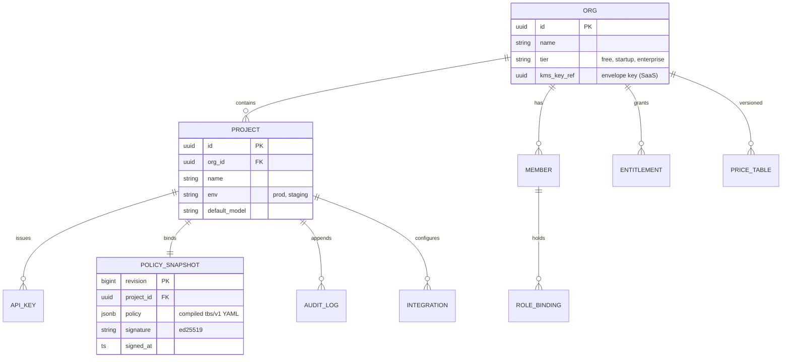

# 06 · Control Plane

**Role of this doc**: multi-tenancy model, RBAC, orgs/projects, entitlements per tier, and alerting.

**Container**: `tbs-control` (Go — CRUD-heavy, no tail-latency SLO; see language rationale in [02](02-data-plane.md)). State: PostgreSQL (source of truth) + ClickHouse (read model for ledger/audit query). The data plane is a *policy client*: it never writes control-plane state directly except via signed event streams.

---

## 1. Multi-tenancy model

| Entity | Key rules |
|---|---|
| **Org** | Billing + entitlement boundary; owns key custody mode (`saas_kms` \| `customer_kms` \| `byoc_env`), price table version, DPA status |
| **Project** | Isolation + policy boundary: one `Policy` revision chain per project; separate API keys, alert routes, attribution namespaces |
| **API key** | Project-scoped, hashed at rest (argon2id), shown once; carries `trajectory_namespace` so loop/circuit state can't leak across keys |
| **Member** | Human user; membership in orgs; scoped console access |
| **Price table** | Versioned per org; edits create new version, never mutate closed periods ([05](05-savings-ledger.md) §1) |

**Hard isolation guarantees**: (a) Postgres **row-level security** — every query forced through `app.tenant_id = current_setting('tbs.tenant_id')`, direct table access without tenant context fails; (b) ClickHouse queries via per-tenant `ROW`-policy + columnar tenant prefix on all tables ([07](07-data-architecture.md)); (c) Redis key prefix `t:{tenant}:` enforced in data-plane code; (d) in-memory data-plane state (trajectory windows, caches) keyed by tenant with no cross-tenant LRU sharing; (e) policy snapshots signed and tenant-stamped — a snapshot from org A fails signature/tenant check in org B's proxy.

---

## 2. RBAC

**Roles** (role-binding: `member → org | project` scope):

| Role | Scope | Console powers | Data-plane effect |
|---|---|---|---|
| `owner` | org | billing, DPA, key custody, delete org, price table | — |
| `admin` | org/project | policies incl. **enforce mode approval**, kill switch, integrations, members | approves rollout stages |
| `developer` | project | policies in observe/advise only, drafts revisions, API keys (issue/revoke) | can promote to advise |
| `analyst` | org | read receipts, ledger, exports (CSV/OTLP), attribution | — |
| `auditor` (read-only, enterprise) | org | audit log, event drill-down, methodology pin | — |
| `billing` | org | receipts, invoices, meter reconciliation | — |

**Enforcement**: JWT (EdDSA) session tokens with `role + scope` claims; policy-write endpoints require `admin` for `mode: enforce` transitions and `kill_switch: true`; all privileged transitions append to the audit log with actor, prior value, new value. **Break-glass**: our support role (`tbs_staff_support`) requires tenant-granted, time-boxed (≤ 4h) access token — enterprise plans get *deny-by-default* support access (`support_access: off` in policy).

---

## 3. Entitlements per tier

Enforced at policy-compile time (invalid rules rejected with `403 entitlement`) **and** at data-plane snapshot load (defense in depth). Free tier degrades *analysis*, never breaks traffic ([02](02-data-plane.md) failure policy).

| Capability | Free (top-of-funnel) | Startup | Enterprise (self-host/BYOC) |
|---|---|---|---|
| Requests analyzed / mo | 10,000 (then observe-only pass-through) | metered (fair-use ceiling by plan) | license-based, unmetered |
| Detectors L0 | ✅ all | ✅ | ✅ |
| Detectors L1 | ✅ | ✅ | ✅ (+ custom models) |
| Detectors L2 | ❌ | ✅ budgeted 3% | ✅ budgeted, **customer-key mode only** option |
| Actuators | observe only (enforce **disabled** — trial is visibility→advise) | cache, clamp, breaker, routing (per-policy rollout) | all + prompt-hygiene opt-in |
| Savings receipt | simplified, projected-only demo | full, billable measured | full + methodology pin + auditor role + CSV/OTLP |
| Attribution | template-hash only | + embedding clustering | + custom labels, cluster naming (L2) |
| Alerting | email digest | Slack + webhook | + PagerDuty, on-prem webhook |
| Key custody | SaaS KMS | SaaS KMS | SaaS KMS *or* customer KMS / BYOC env |
| SSO/SAML, SCIM | ❌ | ❌ | ✅ |
| Support access | community | standard | deny-by-default break-glass |
| Audit retention | 30d | 90d | 365d (+ customer-hosted export) |
| Deployment | SaaS | SaaS | SaaS / BYOC Helm / Docker Compose ([08](08-deployment-topologies.md)) |

**Seat model**: per-seat for console users (aligns with per-seat pricing in [COMPETETIVE_ANALYSIS](../COMPETETIVE_ANALYSIS.md)); data-plane calls are not seat-gated. Seats ≠ API keys (machine traffic unlimited by seats).

---

## 4. Audit log (what gets written)

Append-only (Postgres `audit_log` + daily hash-chain anchor: each row carries `prev_hash = sha256(prev_row_hash || payload)` — tamper-evidence for the "provability" story in [09](09-security-threat-model.md)):

| Event class | Written when |
|---|---|
| policy.revision.created / approved / promoted (stage change) | every compile & rollout transition |
| kill_switch.{rule,project,global}.engaged / released | with actor + reason string |
| actuation.attempted / applied / suppressed / failed | per-rule, per-request (this is the intervention ledger) |
| key.custody.unwrap / denied / kms_error | key lifecycle (no key material logged) |
| access.{login, denied, role_change, support_session_start/end} | auth events |
| ledger.adjustment | disputes ([05](05-savings-ledger.md) §6) |
| tier.degraded | intelligence-budget ladder ([03](03-detection-engine.md) §9) |

**Query surfaces**: console (`/audit`), OTLP log export, CSV for auditors. Retention per tier (table above). Audit rows contain **metadata only** — never payload.

---

## 5. Alerting

**Routes** (per org, forwarded per project filter): Slack (incoming webhook, threaded daily digest + instant on trip), PagerDuty (Events API v2 — for *operational* alerts only: kill-switch engagement, detection degradation, KMS failures, ledger gaps), generic webhook (HMAC-signed body), email digest (free tier).

| Signal | Severity | Default route |
|---|---|---|
| `kill_switch.engaged` (global/project) | critical | PagerDuty + Slack |
| Loop circuit breaker: > N trips/hour vs baseline | warning→critical at 5× | Slack (then PD if sustained) |
| Intelligence budget ratio > 3% sustained 48h | warning | Slack + receipt flag |
| KMS unreachable / key unwrap failures | critical | PagerDuty |
| Ledger gap / meter mismatch > 1% | critical | PagerDuty + billing owner email |
| Feature spend anomaly (`feature` cluster $/h vs 7d baseline) | info→warning | Slack digest |
| Policy `enforce` rollout FP-rate breach (auto-rollback fired) | warning | Slack, links to audit event |
| New tenant traffic / first enforce activation | info | Slack (adoption signal) |

**Alert hygiene**: all alerts carry `tenant, project, rule, rollout%, evidence_event_id`; digest-mode default for non-critical (anti-fatigue); dedupe window 15 min keyed by `(route, signal, rule)`.

---

*Next: [07 — Data Architecture](07-data-architecture.md).*
