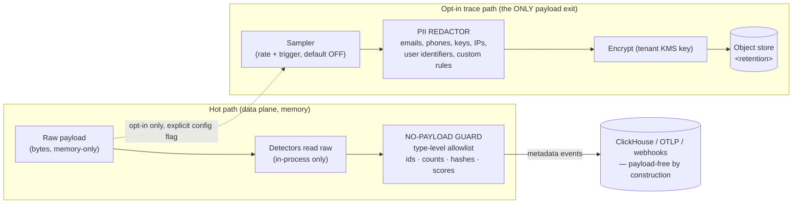

# 07 · Data Architecture

**Role of this doc**: the event schema (explicitly supporting feature-level attribution), the event-store choice with justification, retention tiers, and where the PII-redaction pipeline sits.

---

## 1. What is stored (and what is not)

| Data | Stored? | Where | Notes |
|---|---|---|---|
| Prompt / completion bytes (hot path) | **Never** | — | Memory-only in data plane; dropped at stream end — architectural, see [09](09-security-threat-model.md) |
| Token counts, model, prices, verdicts, rule ids, hashes | ✅ | ClickHouse | The ledger substrate |
| Trajectory **metadata** sequence (tool names, canonical arg hashes, sizes, error-signature hashes) | ✅ (rolling) | ClickHouse (feature events) + Redis (live window) | Loop/context-rot evidence without content |
| Embeddings / simhashes / template skeletons | ✅ | ClickHouse | Derived, non-reversible-ish; see PII note §5 |
| Opt-in sampled traces (redacted) | ✅ (default **off**) | Object store, separate KMS key | Passes redaction gate first ([09](09-security-threat-model.md) §5) |
| API keys | hashed only (argon2id) | Postgres | Vaulted upstream keys in KMS envelope |

**Principle**: the data layer stores **measurements about payloads**, not payloads. Everything downstream (receipts, attribution, alerts) is derivable from measurements — this is what makes zero-retention *compatible* with the savings product rather than in tension with it.

---

## 2. Event schema (feature-level attribution native)

Single wide event table `usage_events` in ClickHouse (plus views), DDL sketch:

```sql
CREATE TABLE tbs_usage_events (
    event_id            String,              -- sha256 content address (idempotency)
    ts                  DateTime64(3),
    tenant_id           String,
    project_id          String,
    trajectory_id       String,
    request_id          String,
    kind                LowCardinality(String),   -- actual|prevented|intelligence_spend|adjustment

    -- actual side
    model_actual        LowCardinality(String),
    model_cf            LowCardinality(String),
    input_tokens        UInt32,
    output_tokens       UInt32,
    cache_read_tokens   UInt32 DEFAULT 0,
    cost_actual_usd     Decimal64(10),
    cost_cf_usd         Decimal64(10),
    prevented_usd       Decimal64(10) DEFAULT 0,
    estimator           LowCardinality(String),   -- measured|projected
    method              LowCardinality(String),   -- route_rewrite|cache_hit|tool_clamp|circuit_breaker|...
    price_table_v       UInt16,
    confidence          Float32,

    -- rule / governance
    rule_id             LowCardinality(String),
    rule_rev            UInt32,
    mode                LowCardinality(String),
    actuator            LowCardinality(String),
    rollout_bucket      UInt16,             -- which lottery bucket (sticky per trajectory)
    action_taken        LowCardinality(String),
    would_act           UInt8,              -- observe/advise would-have-fired
    verdict_scores      String,             -- JSON: detector scores (numbers only)

    -- FEATURE-LEVEL ATTRIBUTION (first-class columns, not JSON-scrum)
    feature_header      String,             -- x-tbs-feature if provided (highest fidelity)
    template_hash       FixedString(16),    -- skeletonized system+first-turn hash
    intent_cluster_id   LowCardinality(String),  -- from L1 clustering
    attr_method         LowCardinality(String),   -- explicit_header|template_hash|embedding_cluster
    attr_confidence     Float32,

    -- detection features (metadata only)
    trajectory_features String,             -- JSON: loop counters, rot score, overfetch refs
    stream              UInt8,              -- 0 request-side, 1 response-side
    latency_ms          UInt32,
    payload_fingerprint FixedString(16)     -- HMAC of normalized body; correlation ONLY, key per-tenant in KMS, rotating 90d
) ENGINE = MergeTree
PARTITION BY toYYYYMM(ts)
ORDER BY (tenant_id, ts, event_id)
TTL ts + INTERVAL 90 DAY;                  -- default tier; per-tenant TTL overrides
```

**Attribution design notes**

1. Feature columns are **materialized, indexed, and grouped on** — not buried in JSON — because per-feature cost/savings is the stated differentiator vs per-call tools (Langfuse gap, [COMPETETIVE_ANALYSIS](../COMPETETIVE_ANALYSIS.md)). `intent_cluster_id` participates in `ORDER BY` of the rollup view, not the raw table (raw stays time-ordered for writes).
2. `feature_header > template_hash > intent_cluster_id` ladder: header is ground truth when customers adopt `x-tbs-feature`; clustering is enriching for everyone else. `attr_method` on every row means the receipt can always disclose *how* it knew.
3. `payload_fingerprint` = HMAC (tenant-keyed, rotating) enables correlation ("did this repeat?") without content — reversibility requires the key (KMS-held), so it is treated as **personal-data-adjacent** under GDPR deletion (deleting tenant key material renders fingerprints unlinkable). Documented in DPA.
4. Redundant event sides in one row (`*_actual`, `*_cf`) rather than two tables: simpler dispute replay (one row = one adjudicable claim), avoids join skew in savings sums.

**OTel mapping** (interop, [constraint #7](README.md)): every event also emitted as OTLP logs with resource attrs `{tenant, project, environment}` and event attrs = column names; `payload_fingerprint` maps to `tbs.fingerprint` (opt-in via `export.send_fingerprints` — default **off** for OTLP, because customers pipe OTel to third-party stores we don't control). Metric companions: `tbs.prevented.usd` (counter, `estimator` label), `tbs.requests.analyzed`, `tbs.intelligence.spend.usd`, `tbs.detector.verdict` (histogram).

---

## 3. Event store choice: ClickHouse (with the contested alternative)

| Requirement | ClickHouse | Postgres (+TimescaleDB) — main alternative |
|---|---|---|
| Write volume at enterprise scale (500M req/mo ≈ 190 events/s avg, 10× bursts) | ✅ columnar bulk inserts, trivially | ⚠️ row inserts need batching + heavy autovacuum; doable at avg, painful at burst |
| Receipt/attribution queries (30d group-by tenant × cluster × rule) | ✅ ms-range on sorted wide rows | ⚠️ partial, needs rollup tables maintained separately |
| TTL retention tiers per tenant | ✅ native `TTL` expression | ⚠️ partition-ish via timescale policies, more glue |
| JSON event burst from N proxies | ✅ Kafka/agent insert path, backpressure-tolerant | ⚠️ connection fan-in managed |
| Transactional policy/RBAC state | ❌ (not its job) | ✅ this is why **Postgres still owns control plane** |
| Ops burden for self-hosted enterprise | ⚠️ extra service in Compose/Helm | ✅ single DB if we only had PG |

**Decision**: ClickHouse for events/ledger; **Postgres for control plane** (already required). At *small scale* (Free tier, single-tenant self-host) the Free tier may route events to Postgres via a pluggable `event_sink` interface — same schema, `JSONB` column set — because adding ClickHouse to a solo-dev Compose file is hostile. The interface boundary (`EventSink::append(event)`) keeps the choice reversible; **default for paid tiers and SaaS: ClickHouse** (justification: the product *is* aggregation over time — receipts are group-bys; the store must make CFO queries cheap).

Alternatives explicitly rejected for primary store: **Snowflake/BigQuery** (cost + latency for online receipts, wrong lifecycle), **Redis-only** (no durable history → disputes impossible), **Kafka as system of record** (retention economics; Kafka *is* used as the transport buffer between proxy fleet and sinks where volume warrants — `tbs.events.v1` topic, partitions by `tenant_id`).

---

## 4. Retention tiers

| Data class | Free | Startup | Enterprise | Enforcement |
|---|---|---|---|---|
| Ledger events (metadata) | 30d | 90d | 365d (or customer-hosted sink) | ClickHouse `TTL` per-partition policy by tier column |
| Audit log | 30d | 90d | 365d + optional export stream | Postgres partition drop job, hash-chain anchored daily |
| Redis live state (trajectory windows, cache) | 2h TTL | 2h | configurable ≤ 24h | TTL at key level, **never persisted** (no AOF/RDB for payload-class keys) |
| Sampled redacted traces | off | off (opt-in) | opt-in, 7/30d | Object-store lifecycle policy, separate KMS key |
| Backpressure spool (metadata only) | 24h | 24h | 72h | Bounded disk spool, crash-recoverable, payload-free by type ([02](02-data-plane.md) §5) |

**Deletion**: tenant-initiated hard delete → purge across ClickHouse (mutation), Postgres (partition), Redis (prefix drop), object store (key material destroy), **and** fingerprint-key destruction option (renders residual rows unlinkable). SLA: 30d contractual, 7d target. This is the operational half of the GDPR mapping in [09](09-security-threat-model.md).

---

## 5. PII redaction pipeline — placement

Redaction is a **stage, not an afterthought**, with two placements that both exist:



1. **Primary placement — before every sink, in the data plane**: the `no-payload guard` is a *typed boundary*: event structs physically cannot carry payload fields (compile-time; see [09](09-security-threat-model.md) §5 "provability hooks"). Redaction here = structural: only allowlisted fields cross. This is why ledger/OTLP/webhook sinks need no regex redaction — they never receive content.
2. **Secondary placement — the trace path**: payload *bytes* may only travel `raw → sampler → redactor → encrypt → object store`. Redactor runs **before** any serialization to disk/network: Presidio-style NER pass + regex patterns (email, phone, AWS keys, JWTs, IPv6, credit cards) + tenant custom rules (`redaction.extra_patterns`); on redactor error → **drop the sample** (fail-closed for persistence; never persist un-redacted). Redaction is versioned (`redactor_rev`) and stamped on stored traces so auditors know which ruleset applied.
3. **L2 sampling crossover**: L2 frontier checks also pass the redactor **pre-call** (config: `l2.redact_before_call: true` default) and use customer keys in BYOC so payloads never reach our model accounts — see [09](09-security-threat-model.md) §4.

**What this buys the auditor**: "we never store payloads" is provable by (a) type-level egress allowlist, (b) syscall/network audit of sinks ([09](09-security-threat-model.md) §6), (c) the single opt-in trace path being visibly redact-then-store. Policy documents claim it; these three mechanisms *demonstrate* it.

---

*Next: [08 — Deployment Topologies](08-deployment-topologies.md).*
