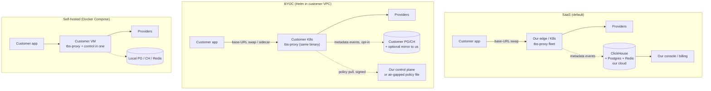

# 08 · Deployment Topologies

**Role of this doc**: the three shipping topologies (SaaS / BYOC / self-hosted), what changes between them, and what **must stay identical**.

**North star**: **one core binary, config-driven topologies.** The `tbs-proxy` artifact is byte-identical across all three (same digest, multi-arch); topology is entirely a function of config + which companion services are attached.

---

## 1. Topology matrix

| Dimension | **SaaS** | **BYOC (Docker-in-VPC, Helm)** | **Self-hosted (Compose)** |
|---|---|---|---|
| Where `tbs-proxy` runs | our K8s, shared-nothing pods per tenant-namespace | customer K8s, Helm chart `tbs-byoc` | customer VM, `docker-compose up` |
| Control plane | our `tbs-control` + hosted Postgres/CH/Redis | hybrid: control plane **read-only mirror** or fully customer-run (license-gated) | fully customer-run, single binary `tbs-control --embedded` (SQLite/PG-lite ok) |
| Data plane ↔ control plane | mTLS to our CP (policy pull, event push) | mTLS pull of **signed policy snapshots** (no live CP dependency for proxy hot path) | local unix socket / localhost |
| Provider keys custody | **our KMS** (envelope) or customer-supplied per-request | **never leave customer VPC**; KMS = customer's (AWS/GCP KMS/Vault transit) | customer env / local Vault |
| L2 frontier checks | our model account (opt-in) OR customer key | **customer key only** (payloads never hit our accounts) | customer key only |
| Event sink | our ClickHouse → receipts/billing | customer CH/PG + **optional signed mirror** to us for aggregate receipts | local only |
| Billing | metered, we bill ([05](05-savings-ledger.md) §6) | annual license; telemetry **opt-in only** (see §3) | annual license; no telemetry |
| Upgrades | we roll, zero-downtime | Helm chart version pin + release notes; we ship images, they apply | Compose image tag bump |
| Tenant isolation | k8s Namespace + RLS + per-tenant KMS key + network policies | single-tenant (their cluster); no multi-tenant concerns | single-tenant |
| Failure domain | ours | theirs (we own only the CP mirror's availability) | theirs |

---

## 2. What must stay **identical** across topologies

These are *product-integrity* invariants — violating any of them breaks the zero-retention claim, the savings methodology, or the interop promise:

1. **The data-plane binary and detection/policy engine** — same digest; no "enterprise build" with different detector math (enterprise gets *more entitlements*, not different arithmetic). Receipts must be reproducible identically in any topology.
2. **The `Policy` schema + compile path + rollout semantics** ([04](04-actuation-layer.md)) — a YAML written for SaaS compiles unchanged in BYOC.
3. **The event schema + counterfactual methodology** ([05](05-savings-ledger.md), [07](07-data-architecture.md)) — the CFO-audit story is topology-independent.
4. **The no-payload architectural guarantees** ([09](09-security-threat-model.md) §5) — the typed egress allowlist ships in every build; "we never store payloads" is true by construction in *all three*, not just SaaS.
5. **The OTLP export surface** — customers pipe to Langfuse/Datadog identically wherever they run ([constraint #7](README.md)).
6. **Observability of our own system** — health, `tier_degraded`, `kill_switch`, `detection_degraded` events are first-class in every topology (BYOC/self-host surface them on their sink; we never require phone-home for the operator to see them).

## 3. What **changes** per topology (explicitly)

| Concern | Change | Config key |
|---|---|---|
| Event sink endpoint | local vs hosted | `sink.endpoint` (+ `sink.mode: local\|mirror\|hosted`) |
| Key custody provider | KMS ARN vs env-file vs Vault addr | `custody.mode`, `custody.<provider>.*` |
| L2 sampling key | our account vs `customer_supplied` | `l2.key_source` |
| Telemetry phone-home | **off by default in BYOC/self-host**; SaaS has no choice (it's our infra) | `phone_home.enabled: false` (default outside SaaS); only license-renewal heartbeat + opt-in anonymized health |
| Control-plane coupling | live vs snapshot-pull vs embedded | `control.mode: live\|snapshot\|embedded` |
| Billing events | pushed to us vs to their meter | `export.billing_events` ([05](05-savings-ledger.md) §6) |
| Persistence class | hosted tiers get object-store trace path; self-host may attach their own object store or leave off | `trace.persistence` |
| Scale knobs | HPA on our fleet vs their replicas | Helm values / Compose `replicas` |

**Phone-home in BYOC — the non-negotiable default**: `phone_home.enabled` defaults **false**; when enabled it carries *no payload, no tenant content*, only: license validity, binary version, coarse health counters. Enterprise compliance reviews routinely grep for egress; we ship with none. License enforcement is a signed license file (offline-verifiable), **not** telemetry.

---

## 4. Artifacts shipped per topology

| Artifact | SaaS | BYOC | Self-hosted |
|---|---|---|---|
| `tbs-proxy` image (distroless, multi-arch: `amd64`,`arm64`) | ✅ (we run) | ✅ (they run) | ✅ (they run) |
| `tbs-control` image | ✅ | optional (or hosted mirror) | ✅ (`--embedded` mode) |
| ONNX L1 model files (quantized, ~40–120MB total) | in image | in image (same digest) | in image |
| Helm chart `tbs-byoc` | — | ✅ (deploys proxy + optional local control + Redis; values for custody/sink) | — |
| `docker-compose.yml` (+ `.env.example`) | — | — | ✅ (proxy + control + PG + CH + Redis) |
| `tbs-policy.yaml` template | ✅ console-generated | ✅ file-based, signed | ✅ file-based |
| License file (self-hosted) | — | ✅ | ✅ |

---

*Next: [09 — Security & Threat Model](09-security-threat-model.md).*
