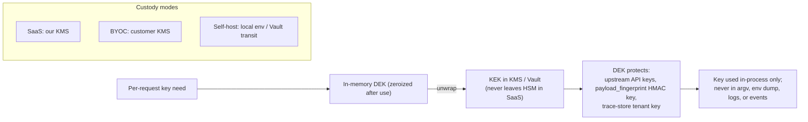

# 09 · Security & Threat Model

**Role of this doc**: STRIDE analysis of the proxy position, secrets handling, audit logging, GDPR/CCPA technical mapping, and the technical hooks that make DPA / zero-retention / EULA claims **true and provable** (not aspirational).

**Trust posture**: the proxy is the most sensitive component a customer can run — it holds API keys and sees every prompt. We design for an enterprise security reviewer whose job is to say no.

---

## 1. STRIDE analysis (proxy position)

| Threat | Vector in this system | Mitigation | Residual |
|---|---|---|---|
| **S**poofing | (a) Customer app → us: fake tenant; (b) us → provider: wrong/leaked key; (c) us → control plane: forged policy | (a) per-project API keys, argon2id-hashed, mTLS optional, tenant claimed-by-key not by header; (b) envelope-encrypted keys unwrapped per-request in memory, never logged, SigV4/Azure signing in-process; (c) policy snapshots Ed25519-signed, proxy verifies signature + tenant stamp before load ([06](06-control-plane.md) §1) | SaaS shared-edge: hostname-based tenant routing must be pinned by key, not SNI alone (reviewed by external pen-test, roadmap §Phase 3) |
| **T**ampering | (a) Policy snapshot in transit/at rest; (b) event stream → ledger; (c) sampled traces | (a) TLS 1.3 + signature verification; (b) content-addressed `event_id` + hash-chain anchor on audit ([06](06-control-plane.md) §4) + meter-vs-receipt reconciliation; (c) traces encrypted under tenant KMS key, integrity tag via GCM | Supply chain: images signed (cosign), SBOM published; customer verifies digest in BYOC |
| **R**epudiation | "You never told me this rule fired" / "you altered my prompt and didn't log it" | Append-only `actuation.*` audit events per attempt (applied/suppressed/failed) with `would_act` for observe/advise; policy revision pinned; every mutation logged with before/after token counts + rule rev ([04](04-actuation-layer.md) §3); hash-chained audit for tamper evidence | Audit is metadata-only by design — cannot prove *content* of a request (this is intentional, and disclosed: content-repudiation is impossible because we don't retain content) |
| **I**nformation disclosure | (a) Payload exfiltration via logs/errors; (b) key leak; (c) cross-tenant bleed; (d) L2 provider receiving payloads; (e) OTLP export to third-party stores | (a) **type-level no-payload guard** at every sink (§5); (b) envelope encryption, key material zeroized after unwrap, never in argv/env/logs; (c) RLS + key prefix + signature tenant-stamp + no shared in-memory state ([06](06-control-plane.md) §1); (d) BYOC L2 = customer key; redaction before any L2 call (default); (e) OTLP sends metadata only by default (`send_fingerprints: false`) | Side-channel timing on cache-hit vs miss (timing oracles) — mitigate with constant-time cache-probe path (Phase 3 hardening item) |
| **D**enial of service | (a) Our outage takes out customer LLM traffic — the catastrophic coupling; (b) attacker floods tenant quota; (c) event-sink lag backpressures proxy | (a) **failure-open by default** ([02](02-data-plane.md) §5): detection/CP/clickhouse failures degrade to passthrough; kill-switch can also disable us entirely; (b) per-tenant rate limits, 429 with Retry-After, entitlements; (c) bounded channels + drop-with-`ledger_gap` event, never block forwarding | A true regional outage still breaks SaaS customers until DNS/SDK fallback — documented in SLA; BYOC exists precisely as the escape hatch ([08](08-deployment-topologies.md)) |
| **E**levation of privilege | (a) Console role escalation to `enforce`; (b) customer bypassing entitlements; (c) support staff reading tenant data | (a) enforce-mode changes require `admin` + separate approval step + audit ([06](06-control-plane.md) §2); (b) entitlements enforced at compile **and** snapshot-load (defense in depth); (c) break-glass access is deny-by-default, tenant-granted, time-boxed, fully audited; no standing staff access to payloads (there are none to read) | Insider with control-plane DB access could alter policy revisions — mitigated by hash-chain + customer-visible revision pins + external auditor drill-down (§7 checklist) |

---

## 2. Secrets handling (envelope encryption)

| Property | Spec |
|---|---|
| Envelope model | Tenant/API keys wrapped by per-tenant DEK, DEK wrapped by KEK in KMS (AWS KMS / GCP KMS / Vault transit in BYOC/self-host). Data plane asks KMS to *use* the key, doesn't long-term-hold DEKs. |
| In-memory hygiene | `zeroize` on drop (Rust crate) for all key buffers; no key material in `Debug`/`Display` (compile-fail tests); no key material in core dumps (mlock + `RLIMIT_CORE=0` in container spec) |
| Transport | TLS 1.3 everywhere (rustls); mTLS data-plane↔control-plane in SaaS/BYOC-snapshot mode |
| Key rotation | KMS-native; DEK rotation doesn't touch data (re-wrap only); `payload_fingerprint` HMAC key rotates 90d, old keys destroyed → historical fingerprints unlinkable (§ GDPR deletion) |
| Customer key for L2 | `l2.key_source: customer_supplied` — key injected per-request from customer secret manager or BYOC env; **never** proxied through our KMS in BYOC ([08](08-deployment-topologies.md) §3) |
| Audit | every unwrap/denied/kms_error logged as audit event **without** key bytes ([06](06-control-plane.md) §4) |

---

## 3. Audit logging (security-relevant)

Already specified in [06 §4](06-control-plane.md); security-critical properties restated here: append-only, hash-chained (`prev_hash`), tenant-partitioned, **metadata-only**, queryable by `auditor` role + OTLP + CSV. Security events that must always fire: `kill_switch.*`, `key.*`, `access.*`, `entitlement.denied`, `secrets_redaction_failure`, `egress_guard.trip`. Alerting routes in [06 §5](06-control-plane.md).

---

## 4. GDPR / CCPA technical mapping

We operate as **Data Processor** (per [COMPETETIVE_ANALYSIS](../COMPETETIVE_ANALYSIS.md) legal section); DPA binds this posture. Technical hooks:

| GDPR/CCPA concept | How the architecture satisfies it | Where |
|---|---|---|
| **Data minimization (Art. 5(1)(c))** | Hot path stores nothing; sinks accept only allowlisted measurement fields; payload bytes never cross the egress guard | [07 §1](07-data-architecture.md), [09 §5](#5-provability-hooks-zero-retention) |
| **Storage limitation (Art. 5(1)(e))** | TTL tiers per class (events 30–365d, Redis 2h, traces opt-in short) | [07 §4](07-data-architecture.md) |
| **Purpose limitation (Art. 5(1)(b))** | L2 explicitly budgeted + redacted + customer-keyed; never trains on customer data (ANTI-GOALS) | [03 §0](03-detection-engine.md), [01 §4](01-system-overview.md) |
| **Erasure (Art. 17) / CCPA delete** | Hard-delete SLA 30d/7d target across CH/PG/Redis/obj-store **+ fingerprint-key destruction** renders residual rows unlinkable | [07 §4](07-data-architecture.md) |
| **Integrity & confidentiality (Art. 32)** | TLS 1.3, envelope KMS, RLS, signatures, zeroization, signed images | §2, [06 §1](06-control-plane.md) |
| **Processor obligations / sub-processors** | L2 frontier providers are sub-processors **only when SaaS-L2 opted-in with our keys**; BYOC+customer-key removes them from the chain entirely | [08 §1](08-deployment-topologies.md) |
| **International transfers** | SaaS: EU-region deployment option pins ClickHouse + KMS to EU; documented transfer mechanism | roadmap Phase 3 |
| **CCPA "sale/sharing"** | None: no cross-context behavioral advertising; no data monetization; explicit "do not sell" honored trivially | policy |
| **Breach notification** | Audit + event sinks give complete picture of what *could* have been accessed (metadata); payload exposure = near-zero by construction, which shrinks the blast radius the DPA must contemplate | §5 |

**DPA-ready artifacts** (shipped as static docs, referenced here): Data Processing Addendum, sub-processor list, zero-retention technical whitepaper (this doc §5 + §6 is its source), DPA-aligned self-hosted EULA ([COMPETETIVE_ANALYSIS](../COMPETETIVE_ANALYSIS.md) legal list).

---

## 5. Provability hooks — what makes "we never store payloads" *auditable*

Policy documents are claims. These are the **mechanisms** an external auditor can run (mirrors the [12](12-self-audit.md) checklist):

1. **Type-level egress allowlist** — event/sink structs are closed types; adding a payload field is a **compile error**, not a code-review miss. Auditor request: "show the type definitions and the build system; try to add a `content` field and show the build fails." (Rust's type system + a CI lint that greps for `String` fields in `events` module.)
2. **Single choke-point sink trait** — all egress (ClickHouse, OTLP, webhooks, object store) goes through one `EventSink`/`TraceSink` implementation that accepts the closed type; no other file may open an outbound connection to a data store (enforced by a CI dependency-graph check + runtime egress filter allowlist in the proxy: only known sink endpoints reachable).
3. **Syscall/network audit mode** — `tbs-proxy --audit-egress` runs a representative workload with `strace`/eBPF (`connect`/`write` to non-provider destinations) and prints every egress; auditor sees: only provider + sink + KMS, and payload-free sizes on the sink paths.
4. **Memory-scope discipline** — sliding windows and ring buffers are per-request, dropped at stream end (Drop impls); no `Arc` of payload escapes to background tasks (auditor: read the buffer-type ownership docs + ASAN/loom tests).
5. **The one and only trace path** is visibly redact-then-encrypt-then-store ([07 §5](07-data-architecture.md)); default-off; auditors can enable it in a test tenant and *see* redaction output before persistence.
6. **External reproducibility** — the `--audit-egress` report + the type definitions + the no-payload-guard trip counter (runtime counter of attempted payload egress, expected **0** in any workload) are the three artifacts enterprise reviewers get in the security questionnaire; they are versioned alongside releases.

This is the difference between a DPA that *says* zero-retention and one whose claims a Big-4 auditor can independently test in an afternoon.

---

## 6. Threat-model open questions (carried to [12](12-self-audit.md))

- SaaS shared-edge hostname/tenant pinning: pen-test scheduled Phase 3.
- Timing side-channel on semantic cache hits: constant-time probe path Phase 3.
- L2 prompt-injection via customer payload → our model account: BYOC customer-key mode is the enterprise answer; SaaS-L2 restricted to redacted, sampled, budgeted calls with per-tenant isolation (rate + account separation).

---

*Next: [10 — Product Unit Economics](10-unit-economics.md).*
