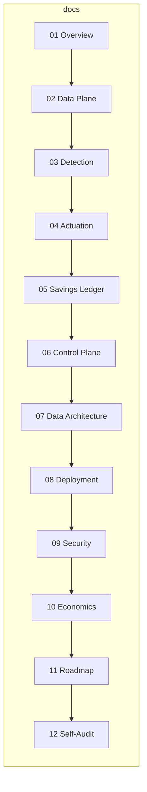

# System Architecture — Token Bleed Shield Platform

**Status**: Draft v0.1 · **Audience**: engineering, security, finance (CFO/auditor) · **Companion docs**: [../ARCHITECTURE.md](../ARCHITECTURE.md) (CLI tool internals), [../COMPETETIVE_ANALYSIS.md](../COMPETETIVE_ANALYSIS.md) (market), [../PREVENTIVE_MANIFESTO.md](../PREVENTIVE_MANIFESTO.md) (thesis)

This folder is the implementation-ready architecture for the waste-prevention
SaaS: an inline layer between customer applications and LLM providers that
**detects and prevents token waste**, priced against measurable savings.

## Reading order

| # | Doc | Read if you are… |
|---|-----|-------------------|
| — | [01-system-overview](01-system-overview.md) | anyone (start here; includes ANTI-GOALS) |
| 1 | [02-data-plane](02-data-plane.md) | proxy/platform engineer |
| 2 | [03-detection-engine](03-detection-engine.md) | ML / detection engineer |
| 3 | [04-actuation-layer](04-actuation-layer.md) | platform engineer, SRE |
| 4 | [05-savings-ledger](05-savings-ledger.md) | finance, product, your CFO counterpart |
| 5 | [06-control-plane](06-control-plane.md) | backend engineer |
| 6 | [07-data-architecture](07-data-architecture.md) | data engineer |
| 7 | [08-deployment-topologies](08-deployment-topologies.md) | DevOps, enterprise prospects |
| 8 | [09-security-threat-model](09-security-threat-model.md) | security, compliance, DPA reviewer |
| 9 | [10-unit-economics](10-unit-economics.md) | founders, finance |
| 10 | [11-roadmap](11-roadmap.md) | everyone (sequencing) |
| 11 | [12-self-audit](12-self-audit.md) | auditor, skeptic |

## How the pieces map

## Ground rules these docs obey

1. **Zero-retention data plane** — payload bytes never reach disk in the hot path; provable by design (see [09](09-security-threat-model.md)).
2. **Streaming-first** — bounded-memory passthrough, never full-response buffering (see [02](02-data-plane.md)).
3. **Tiered intelligence budget** — L0/L1/L2 detection costs ≤ 3% of measured savings (see [03](03-detection-engine.md), [10](10-unit-economics.md)).
4. **Shadow-mode-first** — observe → advise → enforce per policy, kill switch, full audit (see [04](04-actuation-layer.md)).
5. **Savings are the product** — counterfactual ledger is first-class (see [05](05-savings-ledger.md)).
6. **Interop, not lock-in** — OTel-native export; we own intelligence + policy only (see [07](07-data-architecture.md)).
